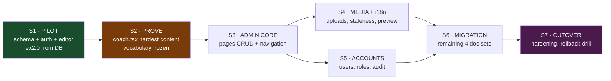

# Development Plan — Coc Docs Platform

> **Version**: 1.0 · **Date**: 2026-09-08 · **Lead**: `architect`
> **Preceding**: [REQUIREMENTS-SPEC.md](../requirements/REQUIREMENTS-SPEC.md) (G1 approved 2026-09-08)
> **Related**: [architecture-overview.md](architecture-overview.md) · [TEST-PLAN.md](TEST-PLAN.md) · [threat-model.md](threat-model.md) · [risk-register.md](risk-register.md) · [sprint-1-tasks.md](sprint-1-tasks.md)
> **Status**: DRAFT — awaiting G2

---

## 1. The Constraint That Shapes Everything

**CONST-RES-01: one part-time developer, no deadline.**

This is not a footnote. It is the reason the plan below looks the way it does, and it drives three decisions:

1. **Every sprint ends in something usable.** No sprint exists purely to build infrastructure for a later sprint.
2. **The riskiest decision is tested first**, at the smallest possible scale, while reversing it is still cheap.
3. **Scope is cut before quality is.** The `Won't` list is real, and the first candidates for further cuts are named in §7.

The honest risk here is not technical failure. It is **RISK-001 — the project stalls**. A plan that only pays off at the end would maximise that risk, so this one front-loads value: after Sprint 1 the PM can already edit five real pages without a deploy.

---

## 2. Epics

| ID | Epic | Requirements | Depends on |
|---|---|---|---|
| **E1** | Foundation — schema, Google auth, role ladder | FR-AUTH-001/002/005/007, ADR-003, ADR-011 | — |
| **E2** | Content model — block schema, BlockNote, renderer | FR-CONT-002/009/010/011, ADR-010 | E1 |
| **E3** | Admin console — pages, navigation, preview | FR-CONT-001/003/004/005/006/007/008/012/013, FR-NAV-001..006 | E1, E2 |
| **E4** | Reader path — DB rendering, ISR, redirects, fallback | FR-READ-001..006, FR-NAV-005, NFR-PERF-01, NFR-AVAIL-02 | E1, E2 |
| **E5** | Translation — staleness, status screen | FR-I18N-001..006, NFR-I18N-01 | E3 |
| **E6** | Media — upload, storage, insertion | FR-MEDIA-001..005, NFR-SEC-UPLOAD | E1, E2 |
| **E7** | Accounts — users, roles, audit | FR-AUTH-003/004/006/008, FR-OPS-001/002/003 | E1 |
| **E8** | Migration — converter, 105 panels, cutover | ADR-010, CONST-OPS-01/03 | E2, E4 |

---

## 3. Sprint DAG



`S4` and `S5` are independent of each other and may be reordered or interleaved freely — useful when part-time availability is uneven.

---

## 4. Sprint Plan

Sprints are sized by **scope and exit criteria, not dates**. With no deadline (Q8) and one part-time developer, committing to dates would produce fiction.

### Sprint 1 — Pilot *(highest value per unit of risk)*
**Goal**: five real pages editable and live, with no deploy.

| Scope | Out of scope |
|---|---|
| Supabase project, schema per ADR-003 | Media, translation status, user management |
| Google sign-in, session (TTL 1 day, AMB-006) | The other four doc sets |
| BlockNote with the 10 block types (ADR-010) | Preview polish, badges, page moves |
| `jex2.0` (5 slugs × 3 locales = 15 versions) migrated by hand | Automated conversion |
| Reader route serving `jex2.0` from the database | |

**Exit criteria**
- The PM edits a `jex2.0` page in the browser and it is live **with zero builds**.
- All 15 versions render acceptably against the current site.
- `content/jex2.0.tsx` and the database path coexist without breaking the other doc sets.

**Why hand-migrate**: 15 versions is small enough to do manually, and doing so is the fastest way to discover what an automated converter would actually need. Building the converter first would be guessing.

### Sprint 2 — Prove the model *(the go / no-go sprint)*
**Goal**: establish whether the 10-block vocabulary survives the hardest content.

- Migrate `coach.tsx` (1,707 lines — the largest file) into blocks.
- Attempt `workflow.tsx`, which embeds `HarnessDemo` and `OwnerTree` → validates the `embed` block (FR-CONT-010).
- Attempt `idea.tsx`, which binds to `ideaData.ts` → validates shared-data rendering.
- **First NFR-USE-01 dry run**: a non-technical colleague edits a migrated page.

**Exit criteria** — one of:
- ✅ The vocabulary holds → freeze it and proceed.
- ⚠️ It needs an 11th or 12th block type → add deliberately, record as an ADR-010 revision, proceed.
- ❌ It cannot be expressed without a raw-HTML escape hatch → **ADR-010 is wrong. Stop and revise before touching the remaining panels.**

> This sprint exists to make failure cheap. Discovering the model is wrong here costs two doc sets of rework; discovering it after Sprint 6 costs a hundred panels.

### Sprint 3 — Admin console core
Pages list and filters · create / edit / soft-delete · draft → preview → publish · version history and restore · optimistic locking · navigation reorder, rename, badges · audit trail on every change.
**Exit**: the PM performs the whole of UC-001, UC-002 and UC-003 without touching code.

### Sprint 4 — Media and translation
Supabase Storage integration · upload with type-sniffing and size validation · clipboard paste · media library · alt text · staleness derivation · translation status screen · missing-translation warning on publish.
**Exit**: UC-006 and UC-007 pass end to end; NFR-I18N-01 measurable from the screen.

### Sprint 5 — Accounts and hardening
Account create / deactivate · role assignment · per-page `min_role` enforced server-side · negative tests for FR-AUTH-008 · sign-in and permission-denied logging · sanitisation hardening · threat-model mitigations closed out.
**Exit**: UC-004 passes, including the negative tests; no unresolved threat at CVSS ≥ 7.0.

### Sprint 6 — Bulk migration
Converter for the common cases · migrate `jex3.0` (8), `idea` (5), `workflow` (7) · **manual review of every panel** · Tier C decision on `ai-usage/guide` and `config` · content-fidelity verification across all 105.
**Exit**: 105 panels in the database, each reviewed, coverage at 100%.

### Sprint 7 — Cutover
Retire `content/*.tsx` · database becomes authoritative (CONST-OPS-03) · load test at 2× SLA · backup and **restore drill** (NFR-OPS-BACKUP) · rollback drill on the `site` branch · **formal NFR-USE-01 task test** · G3 preparation.
**Exit**: G3 evidence complete.

---

## 5. Coexistence During Migration

For Sprints 1–6 the site serves content from **two sources at once**. This is a design requirement, not a transitional hack (architecture-overview §8).

Resolution rule, applied per doc set:

```
request → is this section marked db_backed?
            yes → render from Postgres
            no  → render from content/*.tsx (unchanged path)
```

A single feature flag per section. Migrating a doc set means flipping one flag after its content is verified — which also makes rollback per doc set trivial rather than all-or-nothing.

---

## 6. Traceability

Every requirement maps to a sprint; every sprint task will carry `// req: <REQ-ID>` comments (HARNESS-PROCESS-STANDARD §5.1, greenfield convention).

| Epic | Sprints | Must requirements covered |
|---|---|---|
| E1 | S1 | FR-AUTH-001/002/005/007, NFR-SEC-AUTH, NFR-SEC-SESSION |
| E2 | S1, S2 | FR-CONT-002/009/010/011, NFR-USE-02, NFR-EXT-01 |
| E3 | S3 | FR-CONT-001/003/004/005/006/007/008/012/013, FR-NAV-001..006 |
| E4 | S1, S4 | FR-READ-001..006, FR-NAV-005, NFR-PERF-01, NFR-AVAIL-02 |
| E5 | S4 | FR-I18N-001..006, NFR-I18N-01 |
| E6 | S4 | FR-MEDIA-001..005, NFR-SEC-UPLOAD, FR-OPS-003 |
| E7 | S5 | FR-AUTH-003/004/006/008, FR-OPS-001/002, NFR-SEC-PII |
| E8 | S6, S7 | CONST-OPS-01/03, NFR-OPS-BACKUP, NFR-USE-01 |

The `trace-mapper` agent verifies zero requirements unmapped before G2.

---

## 7. Scope Levers — Named in Advance

If the project starts to stall (RISK-001), cut in this order. Naming them now prevents the harder question being asked under pressure.

| Order | Cut | Cost of cutting |
|---:|---|---|
| 1 | `FR-CONT-014` duplicate page, `FR-NAV-006` badges | Trivial — both are `Could` |
| 2 | `FR-NAV-003` move between sections | Rare operation; a developer can do it in SQL |
| 3 | `FR-MEDIA-003` media library browse/delete | Uploads still work; housekeeping becomes manual |
| 4 | `FR-CONT-012` version restore | **Real loss** — this is one of the git properties being bought back. Cut only with eyes open |
| 5 | Migrate fewer doc sets; leave some on `content/*.tsx` indefinitely | Coexistence (§5) makes this genuinely viable — the bottleneck is removed for whatever is migrated |

**Not cuttable**: NFR-USE-01, NFR-SEC-SANITIZE, NFR-SEC-UPLOAD, FR-CONT-013, FR-OPS-001. The first is the project's purpose; the rest are what make multi-author editing safe.

---

## 8. Staffing

| Role | Who | Notes |
|---|---|---|
| Developer | PM (Socheat-Hun), part-time | Sole implementer |
| Architect / reviewer | PM, with colleague review at G1/G2 | Per proposal §12 |
| NFR-USE-01 test subject | A named non-technical colleague | **Must be identified before Sprint 2** — the first dry run needs them |
| Approver | PM | G1 ✅ · G2, G3 pending |

**Action**: identifying the NFR-USE-01 colleague is a Sprint 1 task, not a Sprint 7 one. The project's central requirement cannot be validated without a specific person willing to be tested.

---

## 9. Definition of Done — per sprint

- All sprint requirements implemented with `// req:` traceability comments
- Unit and integration tests per TEST-PLAN; coverage targets met
- `code-reviewer` static review passed
- 7-dimension self-evaluation ≥ 90/100 `[basis:sg-gw-retrospective,adjustable]`, max 5 remediation rounds then PM escalation
- Sprint log written to `docs/sprints/SPRINT-N-LOG.md`
- L1 hook clean on every commit; L2 green on every PR

---

## 10. Open Items Into Sprint 1

| Item | Owner |
|---|---|
| Identify the NFR-USE-01 colleague (§8) | PM |
| Tier C disposition — `ai-usage/guide`, `config` | Deferred to Sprint 6 |
| Whether `.tree` diagrams need an 11th block type (ADR-010) | Measured in Sprint 2 |
| Supabase region and backup schedule | Sprint 1 |
