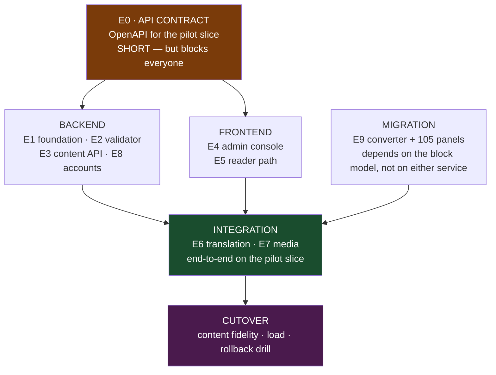

# Development Plan — Coc Docs Platform

> **Version**: 2.0 · **Date**: 2026-09-09 · **Lead**: `architect`
> **Supersedes**: v1.0 (2026-09-08), written for one part-time developer and a single-service architecture
> **Related**: [architecture-overview.md](architecture-overview.md) · [TEST-PLAN.md](TEST-PLAN.md) · [threat-model.md](threat-model.md) · [risk-register.md](risk-register.md) · [ADR-012](adr/ADR-012-revision-of-001-backend-stack.md)
> **Status**: DRAFT — awaiting G2

---

## 1. What Changed, and Why This Plan Looks Different

Version 1.0 was shaped by one constraint above all others: **one part-time developer, no deadline**. That is why it used thin vertical slices, named its scope levers in advance, and ranked *"the project stalls"* above every technical risk.

Two things have since changed:

| | v1.0 | v2.0 |
|---|---|---|
| Team | 1 part-time developer | **6 developers** (CONST-RES-02) |
| Architecture | one Next.js app | **two services** (CONST-TECH-05) |
| Hosting | undecided | **Google Cloud** (ADR-012 §2.1) |

**The dominant risk has moved.** With one person, the danger was stalling. With six people and two services, the danger is **divergence** — the backend and frontend drifting apart, work colliding, and integration deferred until it is expensive. The plan below is built against that instead.

The trade is real: v1.0 could not go fast, but it also could not get out of sync with itself.

---

## 2. Epics

| ID | Epic | Requirements | Workstream |
|---|---|---|---|
| **E0** | **API contract** — OpenAPI for the pilot slice | CONST-TECH-05 | shared, first |
| **E1** | Foundation — schema, Google OIDC, role ladder | FR-AUTH-001/002/005/007, ADR-003, ADR-011 | backend |
| **E2** | Content model — Java block types + authoritative validator | FR-CONT-002/009/010/011, CONST-TECH-07, ADR-010 | backend |
| **E3** | Content API — pages, drafts, publish, versions | FR-CONT-001/003/005/006/007/008/012/013 | backend |
| **E4** | Admin console — editor, navigation, preview | FR-CONT-001..008, FR-NAV-001..006 | frontend |
| **E5** | Reader path — DB rendering, ISR, redirects, fallback | FR-READ-001..006, NFR-PERF-01, NFR-AVAIL-02 | frontend |
| **E6** | Translation — staleness, status screen | FR-I18N-001..006, NFR-I18N-01 | both |
| **E7** | Media — upload, S3 storage, insertion | FR-MEDIA-001..005, NFR-SEC-UPLOAD | both |
| **E8** | Accounts — users, roles, audit | FR-AUTH-003/004/006/008, FR-OPS-001/002/003 | backend |
| **E9** | Migration — converter, 105 panels, cutover | ADR-010, CONST-OPS-01/03 | migration |

---

## 3. Workstreams

Three parallel tracks that meet at the API contract.



**Migration runs from day one.** It depends on the block model (settled in ADR-010), not on either service being finished. With six people that is a genuine third track rather than something squeezed in at the end — and it is the largest single body of work (105 panels, ~14k lines).

---

## 4. Suggested Ownership

Provisional. **Swap freely** — this is based on nothing but the review assignments, and the team knows its own strengths.

| Track | Suggested | Notes |
|---|---|---|
| Backend — foundation, auth, accounts | Panha, Chanthy | Auth and roles are the security-critical part |
| Backend — content API, validator | Chanthy | Reviewed ADR-010, already knows the block model |
| Frontend — admin console, editor | Sophanna, Sreyly | BlockNote integration is the largest frontend risk |
| Frontend — reader path, ISR | Sreyly | |
| Migration — converter, content | Sarayuth, PM | Needs judgement about the existing content more than framework depth |
| API contract, review, integration | PM | Also the only G2/G3 approver |

**One rule regardless of who does what: nobody owns a whole vertical alone.** Every piece needs a second person who can review it, because with six people the review is what keeps the design coherent.

---

## 5. Sprint Plan

Sprints are sized by **scope and exit criteria, not dates**. No deadline exists (Q8), and inventing one would produce fiction.

### Sprint 0 — Contract and setup *(short, blocks everything)*
- OpenAPI for the pilot slice: read a page, save a draft, publish, list navigation
- Everyone runs local PostgreSQL + pgAdmin, applies Flyway, gets `mvn compile` green
- **Toolchain alignment: Java 21 for everyone.** One developer is currently on Java 25 — that is exactly the divergence this sprint exists to catch
- CI green on both services

**Exit**: the contract is agreed and committed; six machines build identically.

### Sprint 1 — Pilot *(the proof)*
**Goal: five real pages editable in a browser, live, with no deploy.**

| Backend | Frontend | Migration |
|---|---|---|
| Google OIDC verification, session, role ladder | Admin shell, BlockNote wired to the 10 block types | Hand-migrate `jex2.0` — 5 slugs × 3 locales |
| Java block validator (authoritative) | Draft save / preview / publish against the API | Record actual minutes per panel |
| Page + draft + publish endpoints | Reader route serving `jex2.0` from the API | |

**Exit criteria**
- A `jex2.0` page is edited in the browser and is live, **with zero builds**
- All 15 versions render acceptably against the current site
- The other four doc sets still render from `content/*.tsx`, unbroken
- Direct-API negative tests pass: a `user` cannot write, an `admin` cannot reach account management

**Why hand-migrate**: 15 versions is small enough to do manually, and doing so is the only honest way to learn what a converter must handle. Building the converter first is building against a guess.

### Sprint 2 — Prove the model *(go / no-go)*
- Migrate `coach.tsx` — 1,707 lines, the hardest content
- Attempt `workflow.tsx` → validates the `embed` block against `HarnessDemo` / `OwnerTree`
- Attempt `idea.tsx` → validates shared-data rendering from `ideaData.ts`
- **First NFR-USE-01 dry run with Pann Voleak**

**Exit** — one of:
- ✅ Vocabulary holds → freeze it, proceed
- ⚠️ Needs an 11th or 12th block type → add deliberately, revise ADR-010, proceed
- ❌ Cannot be expressed without a raw-HTML escape hatch → **ADR-010 is wrong. Stop and revise before touching the other ~100 panels.**

> This sprint exists to make failure cheap. Discovering the model is wrong here costs two doc sets. Discovering it after Sprint 5 costs a hundred panels.

### Sprint 3 — Admin console complete
Pages list and filters · soft delete · version history and restore · optimistic locking end to end · navigation reorder, rename, badges · audit trail on every change.
**Exit**: UC-001, UC-002 and UC-003 pass without touching code.

### Sprint 4 — Media and translation
S3 storage · upload with content-type sniffing and size validation · clipboard paste · media library · alt text · staleness derivation · translation status screen.
**Exit**: UC-006 and UC-007 pass; NFR-I18N-01 measurable from the screen.

### Sprint 5 — Accounts, hardening, bulk migration
Account create / deactivate · role assignment · per-page `min_role` enforced server-side · **negative tests for FR-AUTH-008 by direct API call** · sanitisation hardening · threat-model mitigations closed out · converter for common cases · migrate `jex3.0`, `idea`, `workflow` with **manual review of every panel**.
**Exit**: UC-004 passes including negative tests; no unresolved threat at CVSS ≥ 7.0; 105 panels migrated and reviewed.

### Sprint 6 — Cutover
Retire `content/*.tsx` · database authoritative (CONST-OPS-03) · load test at 2× SLA · backup and **restore drill** · rollback drill on the `site` branch · **formal NFR-USE-01 task test with Pann Voleak** · G3 preparation.

---

## 6. Coexistence During Migration

Through Sprints 1–5 the site serves content from **two sources at once**. This is a design requirement, not a transitional hack.

```
request → is this section marked db_backed?
            yes → fetch from the backend API
            no  → render from content/*.tsx (unchanged path)
```

One flag per section. Migrating a doc set means flipping one flag after its content is verified — which also makes rollback per doc set rather than all-or-nothing.

---

## 7. Coordination — the new cost

With six developers, these are not optional overhead. They are what stops the parallelism becoming divergence.

| Practice | Why |
|---|---|
| **API contract is committed and reviewed** | The seam most likely to break, and it breaks silently |
| **Contract tests in CI on both sides** | Drift is caught by the machine, not by a person noticing |
| **Integrate on the pilot slice from Sprint 1** | Two services that meet for the first time in Sprint 5 will not meet well |
| **Everyone on Java 21** | Already one divergence observed on day one |
| **No vertical owned alone** | Review is what keeps six people's work coherent |
| **`// req: <REQ-ID>` comments** | Traceability, HARNESS-PROCESS-STANDARD §5.1 |

---

## 8. Traceability

| Epic | Sprints | Must requirements |
|---|---|---|
| E0 | 0 | CONST-TECH-05 |
| E1 | 1 | FR-AUTH-001/002/005/007, NFR-SEC-AUTH, NFR-SEC-SESSION |
| E2 | 1 | FR-CONT-009/010/011, CONST-TECH-07, NFR-SEC-SANITIZE |
| E3 | 1, 3 | FR-CONT-001/003/005/006/007/008/012/013 |
| E4 | 1, 3 | FR-CONT-002, FR-NAV-001..006, NFR-USE-01/02 |
| E5 | 1, 4 | FR-READ-001..006, NFR-PERF-01, NFR-AVAIL-02 |
| E6 | 4 | FR-I18N-001..006, NFR-I18N-01 |
| E7 | 4 | FR-MEDIA-001..005, NFR-SEC-UPLOAD, FR-OPS-003 |
| E8 | 5 | FR-AUTH-003/004/006/008, FR-OPS-001/002, NFR-SEC-PII |
| E9 | 1, 2, 5, 6 | CONST-OPS-01/03, NFR-OPS-BACKUP, NFR-USE-01 |

`trace-mapper` verifies zero unmapped requirements before G2.

---

## 9. Scope Levers

Still named in advance. Less likely to be needed with six people, but naming them now prevents the harder question being asked under pressure.

| Order | Cut | Cost |
|---:|---|---|
| 1 | `FR-CONT-014` duplicate page, `FR-NAV-006` badges | Trivial — both `Could` |
| 2 | `FR-NAV-003` move between sections | Rare; a developer can do it in SQL |
| 3 | `FR-MEDIA-003` media library browse/delete | Uploads still work; housekeeping manual |
| 4 | `FR-CONT-012` version restore | **Real loss** — one of the git properties being bought back |
| 5 | Migrate fewer doc sets | Coexistence makes this genuinely viable |

**Not cuttable**: NFR-USE-01, NFR-SEC-SANITIZE, NFR-SEC-UPLOAD, FR-CONT-013, FR-OPS-001, and the authoritative backend validator (CONST-TECH-07). The first is the project's purpose; the rest are what make multi-author editing safe.

---

## 10. Definition of Done — per sprint

- Requirements implemented with `// req:` traceability comments
- Unit, integration and **contract** tests per TEST-PLAN; coverage targets met
- `code-reviewer` static review passed — **by someone other than the author**
- 7-dimension self-evaluation ≥ 90/100, max 5 remediation rounds then PM escalation
- Sprint log at `docs/sprints/SPRINT-N-LOG.md`
- L1 hook clean on every commit; L2 green on every PR, both services

---

## 11. Open Items

| Item | Owner |
|---|---|
| Production database provider — before first deploy, not before first commit (ADR-012 §2.3) | PM |
| Confirm Pann Voleak's Workspace provisioning and explicit consent to be tested | Sreyly |
| Tier C disposition — `ai-usage/guide`, `config` | Sprint 5 |
| Whether `.tree` diagrams need an 11th block type | Measured in Sprint 2 |
| Java 21 alignment across all six machines | Sprint 0 |
