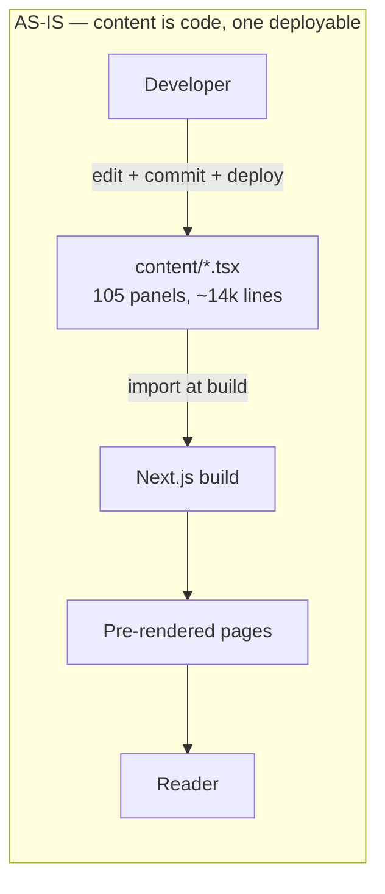
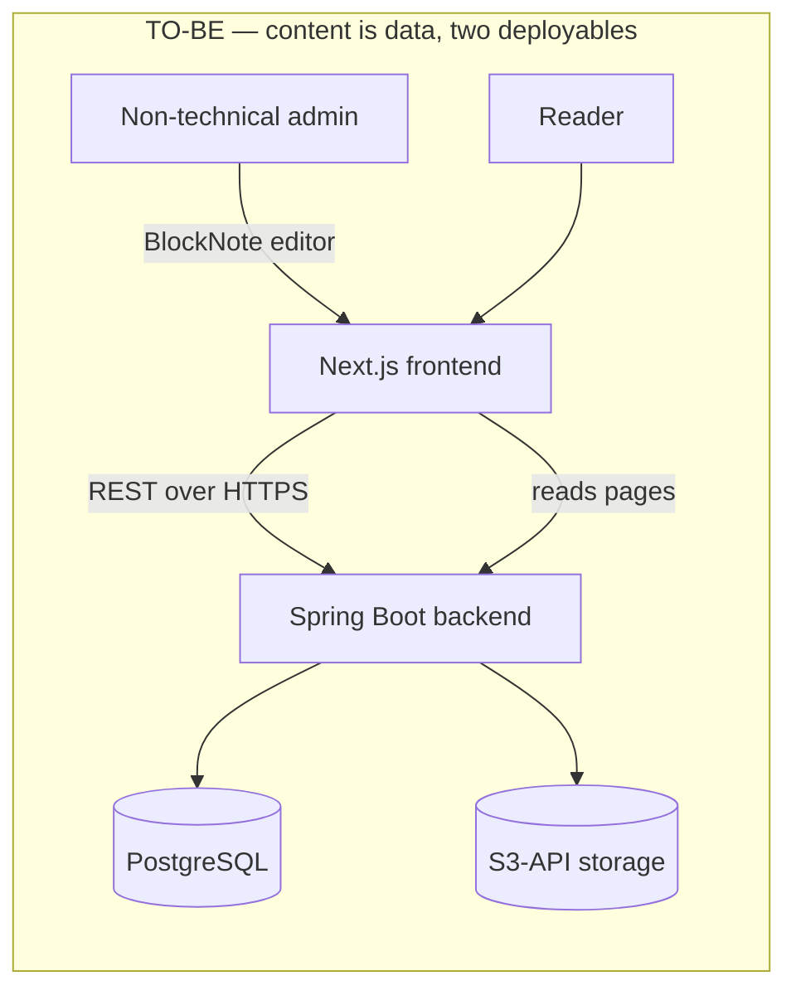
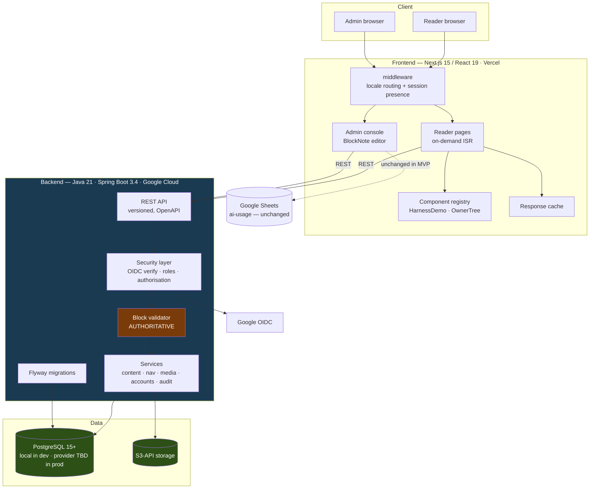
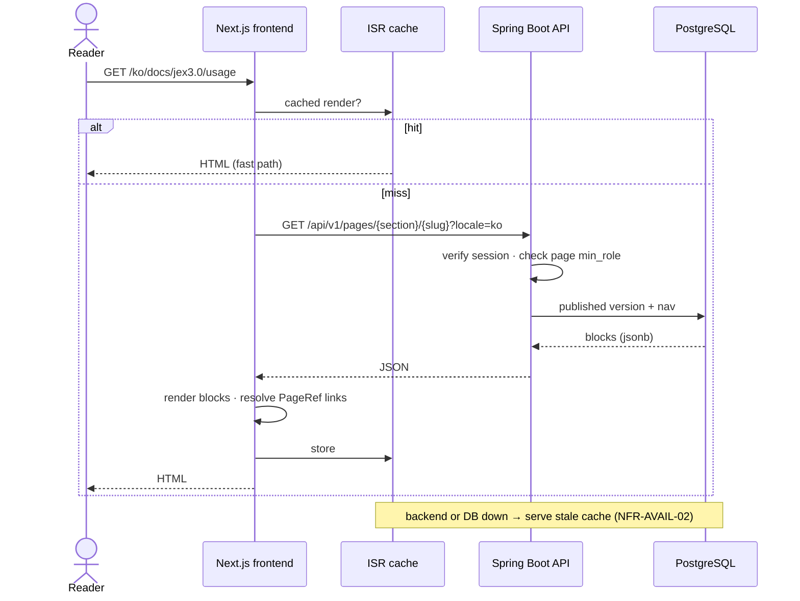
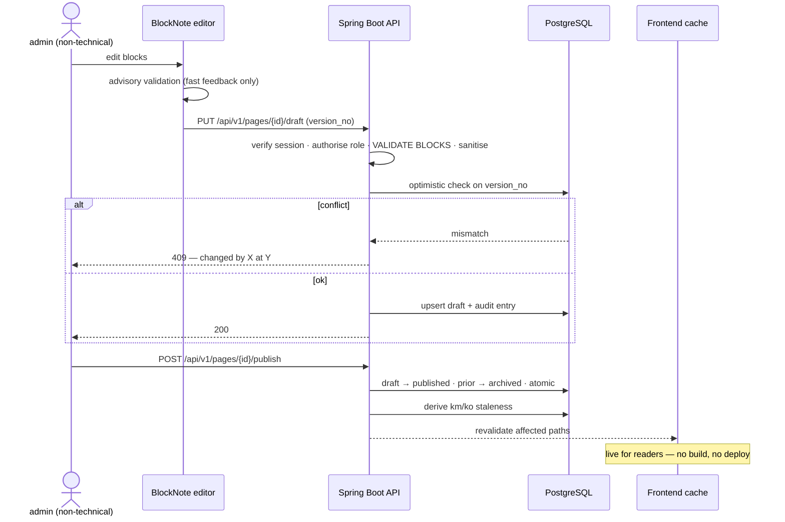
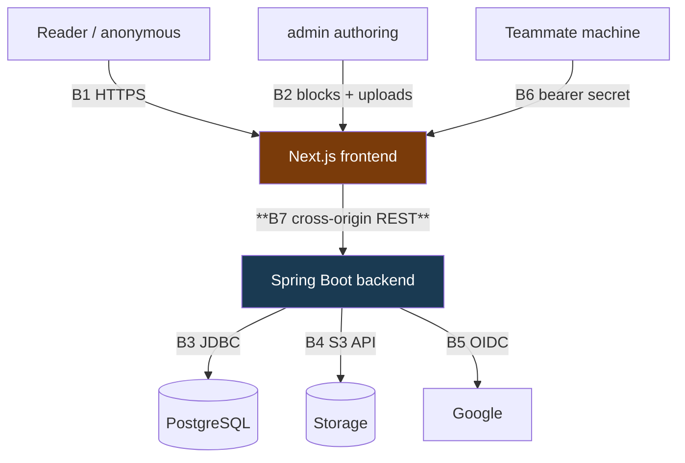

# Architecture Overview — Coc Docs Platform

> **Version**: 2.0 · **Date**: 2026-09-09 · **Author**: `architect`
> **Supersedes**: v1.0 (2026-09-08), which described a single-service Next.js system
> **Related**: [ADR-012](adr/ADR-012-revision-of-001-backend-stack.md) · [ADR-003](adr/ADR-003-persistence-strategy.md) · [ADR-010](adr/ADR-010-content-model.md) · [ADR-011](adr/ADR-011-security-model.md) · [threat-model.md](threat-model.md)

**What changed in v2.0**: the system is now **two services** (CONST-TECH-05) — a Java 21 / Spring Boot backend and a Next.js frontend — deployed to **Google Cloud** (ADR-012 §2.1), built by **six developers** (CONST-RES-02).

---

## 1. Shape of the Change

Still not a rewrite. The reader-facing site keeps its URLs, its look and its locale routing. What changes is where content comes from, who can change it, and where the rules are enforced.

The developer disappears from the content path. That remains the entire point.

---

## 2. Component View

| Component | Service | Notes |
|---|---|---|
| Reader pages | frontend | `generateStaticParams` + `dynamicParams:false` replaced by on-demand ISR — this is what makes "add a page without a deploy" possible |
| Admin console | frontend | **New.** BlockNote editor, navigation, translation status, media, users |
| Component registry | frontend | Closed map of embeddable components (ADR-010 §4) |
| Security layer | backend | Verifies Google ID tokens, resolves role from the database, authorises **every** request |
| Block validator | backend | **Authoritative** (CONST-TECH-07). The frontend copy is advisory only |
| Flyway | backend | Same `V1__initial_schema.sql` in every environment, local included |
| Google Sheets / ai-usage | frontend | **Unchanged.** `FR-USAGE-001` is `Won't` for MVP |

---

## 3. Where the Rules Live

The single most important property of this architecture:

> **The frontend enforces nothing.** It holds no database credentials, applies no authorisation, and its validation is a convenience for the editor. Every rule that matters is enforced in the backend, or it is not enforced at all.

This is not a stylistic preference. Anyone can call the API directly with `curl` and skip the entire frontend. If a rule lives only in the browser, it does not exist.

| Rule | Enforced in | Why not the frontend |
|---|---|---|
| Who may read a page (`min_role`) | backend | A direct API call bypasses any UI check |
| Who may edit or publish | backend | Same |
| Block schema validity | backend | An attacker sends whatever JSON they like |
| Link scheme safety (`javascript:` etc.) | backend | Sanitising at render time is one layer too late |
| Upload type and size | backend | Client-side checks are advisory at best |
| Optimistic locking | database | A partial unique index and `version_no`, not application logic |

Consequence for testing: **every authorisation test must call the API directly.** A test that drives the browser proves the UI hides the button, not that the server refuses the request (TEST-PLAN §5).

---

## 4. Read Path

**The cache is load-bearing, not an optimisation.** Today's pages are pre-rendered and survive a total backend outage. With two services there are now *two* things that can fail between a reader and their documentation. NFR-AVAIL-02 buys that resilience back, and NFR-PERF-01 (P95 < 1s) is only reachable through it — reads are slower than today by design (AMB-005).

---

## 5. Write Path

That final note is the project KPI: **zero deploys for content changes.**

---

## 6. The API Contract

New, and the main coordination cost of splitting the system.

- **OpenAPI, versioned** under `/api/v1`. The specification is generated from the backend and committed, so drift is visible in review.
- **The frontend consumes it; nothing else does.** No other client is planned or supported.
- **Contract tests run in CI on both sides.** With six developers working in parallel, the backend and frontend can drift within a single day. The contract is the seam most likely to break, and it breaks silently — which is why it is tested rather than trusted (TEST-PLAN §5).

---

## 7. Trust Boundaries

Analysed with STRIDE and scored in [threat-model.md](threat-model.md).

| ID | Boundary | New in v2.0? |
|---|---|---|
| B1 | Reader → frontend | no |
| B2 | Admin → frontend | no |
| **B7** | **Frontend → backend, cross-origin** | **YES — the significant addition.** CORS policy, cookie `SameSite` across origins, credentials on every request, and API-level attacks the UI would never send: mass assignment, over-posting, IDOR on endpoints. |
| B3 / B4 | Backend → PostgreSQL / storage | credentials moved from the Next.js server to the backend |
| B5 | Backend → Google OIDC | token verification moved to the backend; the frontend never asserts identity |
| B6 | Ingest endpoint | unchanged, scope-limited, not a template for editorial writes |

---

## 8. Environments

| | Frontend | Backend | Database | Storage |
|---|---|---|---|---|
| **Local** | `next dev` | `mvn spring-boot:run` | **local PostgreSQL** + pgAdmin | local S3-compatible or a stub |
| **Production** | Vercel | **Google Cloud** | provider open (ADR-012 §2.3) | S3 API |

**Local development needs no cloud account.** Flyway applies the same `V1__initial_schema.sql` locally as in production, so the schema is identical from the first commit.

> pgAdmin is the administration client, **not** the database. Both are required: PostgreSQL 15+ server, plus pgAdmin to manage it.

**The production database provider is deliberately open** and does not block G2. `CONST-TECH-08` keeps the design portable — plain PostgreSQL over JDBC, Flyway migrations, S3-API storage — so switching provider costs a connection string and a storage endpoint.

---

## 9. Content Tiering

Unchanged from v1.0. Not all 105 panels become admin-editable.

| Tier | Content | Treatment |
|---|---|---|
| **A** | prose, tables, code, callouts, steps — the large majority | → database, fully editable |
| **B** | `workflow` panels embedding `HarnessDemo` / `OwnerTree`; `idea` panels bound to `ideaData.ts` | → stay in frontend code, referenced by an `embed` block |
| **C** | `ai-usage/guide`, `ai-usage/config` | → decided in Skill 2 follow-up |

Tier B is a **cost lever, not a compromise**: non-technical staff were never going to edit an interactive demo.

---

## 10. What Is Deliberately Not Changing

| Kept | Why |
|---|---|
| Next.js / React / TypeScript / Vercel **for the frontend** | CONST-TECH-01/02 |
| Locale routing and `/{lang}/docs/...` URLs | FR-READ-002, CONST-OPS-02 — inbound links must keep working |
| `lib/usage/*` and Google Sheets | `FR-USAGE-001` is `Won't` |
| `PageFx` copy-button enhancement | Reused for `code` blocks with `copyable: true` |
| Styled 404, `PendingTranslation` | Generalised from per-page hacks into system behaviour |
| The database schema | ADR-003 is language-neutral and survived the stack change unchanged |

---

## 11. Sequencing Implication

With six developers (CONST-RES-02), the two services are the natural parallel split — but they meet at the API contract, and that seam has to exist before either side can move fast.

1. **Contract first** — OpenAPI for the pilot slice, agreed by both sides. Short, but it unblocks everyone.
2. **Then parallel** — backend services and frontend editor proceed independently against the agreed contract.
3. **Migration in parallel with both** — the content converter depends on the block model (settled), not on either service being finished.
4. **Coexistence during migration** — `section.db_backed` flips one doc set at a time, so migration is incremental and rollback is per-section rather than all-or-nothing (CONST-OPS-03).

See [DEV-PLAN.md](DEV-PLAN.md) §3 for the workstream breakdown.
