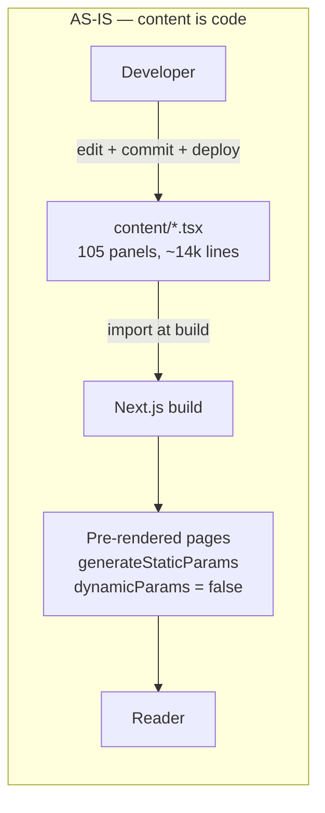
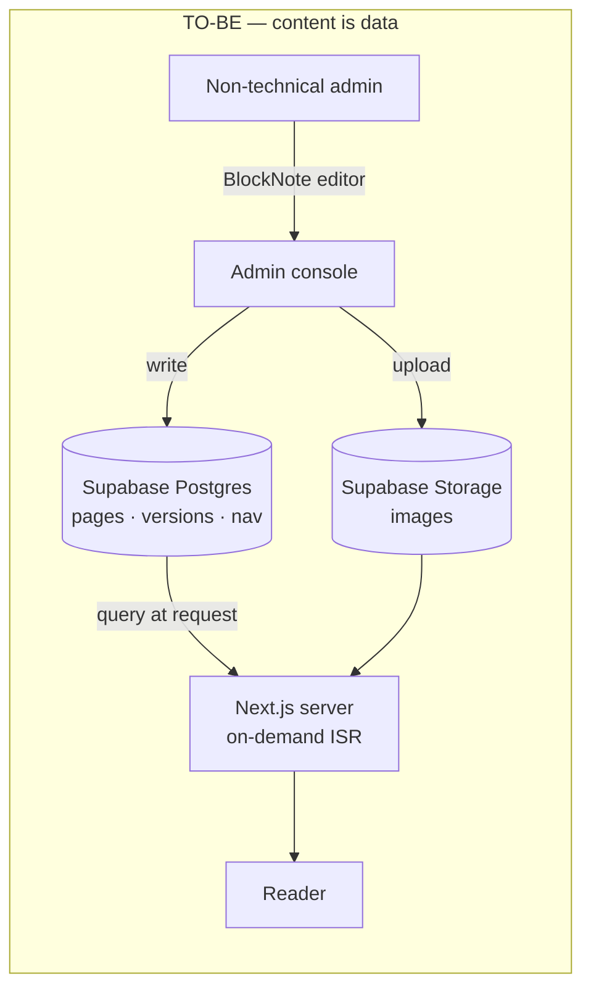
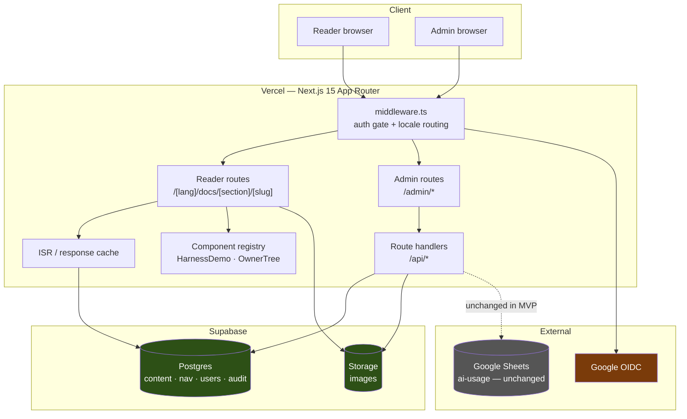
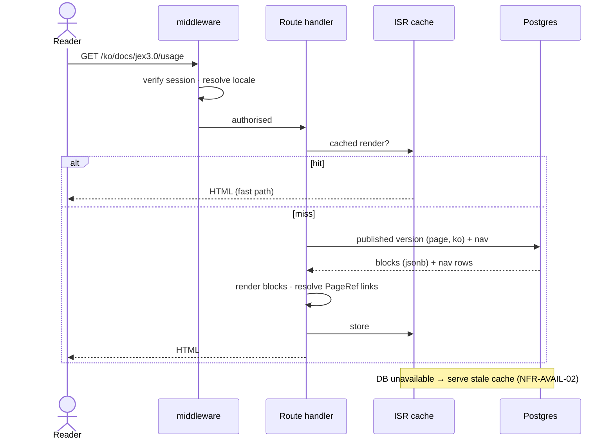
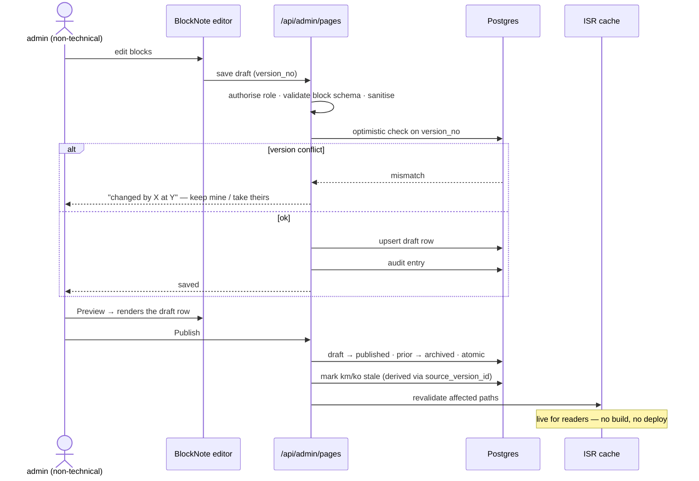
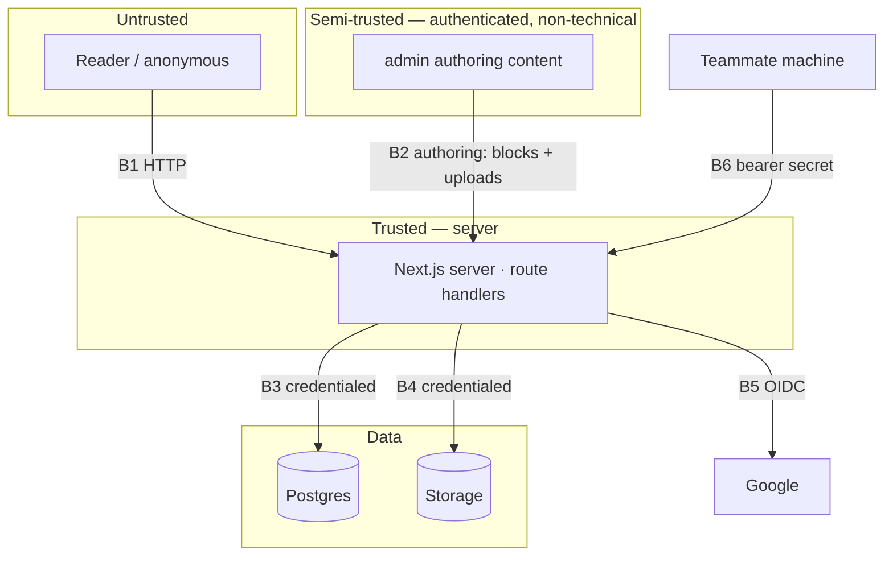
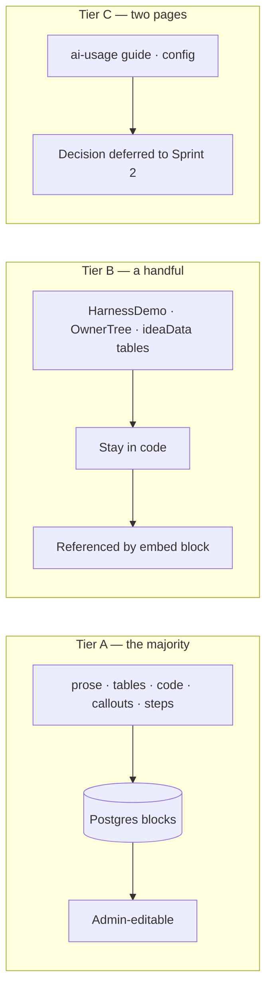

# Architecture Overview — Coc Docs Platform

> **Version**: 1.0 · **Date**: 2026-09-08 · **Author**: `architect`
> **Related**: [ADR-001](adr/ADR-001-tech-stack.md) · [ADR-003](adr/ADR-003-persistence-strategy.md) · [ADR-010](adr/ADR-010-content-model.md) · [ADR-011](adr/ADR-011-security-model.md) · [threat-model.md](threat-model.md)

---

## 1. Shape of the Change

This is **not** a rewrite. The Next.js application stays; what changes is where content comes from and who can change it.

The developer disappears from the content path. That is the whole project.

---

## 2. Component View

| Component | New? | Notes |
|---|---|---|
| `middleware.ts` | modified | Keeps locale routing; auth gate switches from shared-password cookie to Google session, and gains per-page `min_role` checks |
| Reader routes | modified | `generateStaticParams` + `dynamicParams: false` → **on-demand ISR**. This is the change that makes "add a page without a deploy" possible |
| Admin routes | **new** | The console: pages, editor, navigation, translation status, media, users |
| Component registry | **new** | Closed server-side map of embeddable components (ADR-010 §4) |
| Postgres | **new** | Content, navigation, users, roles, audit |
| Storage | **new** | Uploaded images — no equivalent exists today |
| Google Sheets / ai-usage | **unchanged** | `FR-USAGE-001` is `Won't` for MVP; `lib/usage/*` is untouched |

---

## 3. Read Path

**Why the cache is load-bearing, not an optimisation.** Today every page is pre-rendered and survives a total backend outage. Once content lives in the database, the database becomes a single point of failure *for reading documentation*. NFR-AVAIL-02 exists to buy that resilience back, and NFR-PERF-01 (P95 < 1s) is only reachable through it — reads are slower than today by design (AMB-005).

---

## 4. Write Path

The final note is the project's KPI: **zero deploys for content changes.**

---

## 5. Trust Boundaries

Enumerated here; analysed with STRIDE and scored in [threat-model.md](threat-model.md).

| ID | Boundary | Principal new risk |
|---|---|---|
| B1 | Reader → server | Standard web surface; widens materially in phase 2 when readers become anonymous |
| **B2** | **Admin → server** | **The new one.** Semi-trusted humans submit structured content and binary files. Mitigated structurally: no raw-HTML block exists (ADR-010 §3), block schema validated on write, uploads sniffed not trusted |
| B3 / B4 | Server → Supabase | Credentialed; secrets never reach the client |
| B5 | Server → Google OIDC | Sole authentication dependency; no local password fallback by design (FR-AUTH-002) |
| B6 | Ingest endpoint | Pre-existing shared bearer secret. Scope-limited and explicitly **not** a pattern for editorial writes (NFR-SEC-CHANNEL) |

---

## 6. Content Tiering

Not all 105 panels become editable. Established at Q4 and carried into ADR-010.

Tier B is a **cost lever, not a compromise**: non-technical staff were never going to edit an interactive demo, so paying to make it editable buys nothing.

---

## 7. What Is Deliberately Not Changing

| Kept | Why |
|---|---|
| Next.js / React / TypeScript / Vercel | CONST-TECH-01/02 — working, known, already paid for |
| Locale routing and `/{lang}/docs/...` URL shape | Preserves inbound links; FR-READ-002 and CONST-OPS-02 require it |
| `lib/usage/*` and the Google Sheets backend | `FR-USAGE-001` is `Won't`; migrating it serves no stated driver |
| `PageFx` copy-button enhancement | Reused for `code` blocks with `copyable: true` |
| The styled 404 and `PendingTranslation` patterns | Generalised from per-page hacks into system behaviour (FR-READ-004, FR-READ-006) |

---

## 8. Sequencing Implication

The architecture is deliberately **shippable in slices**, because CONST-RES-01 permits nothing else:

1. **Pilot** — schema + editor + one doc set (`jex2.0`, 5 pages) rendered from the database, with the rest still served from `content/*.tsx`. Both paths coexist.
2. **Prove the model** against the hardest content (`coach.tsx`) before mass migration.
3. **Migrate** remaining doc sets one at a time.
4. **Cut over** — `content/*.tsx` retired; the database becomes authoritative (CONST-OPS-03), with the `site` branch retained as the rollback path until sign-off.

Coexistence of the two content sources during migration is a first-class design requirement, not a transitional hack — see DEV-PLAN §4.
