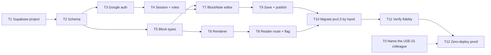

# Sprint 1 Task List — Pilot

> **Version**: 1.0 · **Date**: 2026-09-08
> **Goal**: **Five real pages editable in a browser and live, with zero builds.**
> **Doc set**: `jex2.0` — 5 slugs × 3 locales = 15 versions, 534 lines (en). The smallest set on the site.
> **Related**: [DEV-PLAN.md §4](DEV-PLAN.md) · [ADR-001](adr/ADR-001-tech-stack.md) · [ADR-003](adr/ADR-003-persistence-strategy.md) · [ADR-010](adr/ADR-010-content-model.md) · [ADR-011](adr/ADR-011-security-model.md)

Sprint 1 is deliberately a **vertical slice**, not a foundation layer. At the end of it the bottleneck is gone for five pages — which proves the whole thesis on real content before another hundred panels are touched.

---

## Task DAG

---

## Tasks

### Setup

| ID | Task | Req | Exit criterion |
|---|---|---|---|
| **T0** | **Identify the NFR-USE-01 colleague by name** and confirm they will be tested | NFR-USE-01 | A specific person has agreed. Not a role — a name. |
| T1 | Create Supabase project; region and backup schedule chosen; credentials into Vercel env | ADR-001 | Connects from local and from Vercel |
| T2 | Schema migration: `section`, `page`, `page_version`, `page_slug_history`, `account`, `audit_log` | ADR-003 | Partial unique index enforces one published row per (page, locale) |

> **T0 first, deliberately.** The project's central requirement cannot be validated without a real person, and leaving it until Sprint 7 is how RISK-013 happens.

### Authentication

| ID | Task | Req | Exit criterion |
|---|---|---|---|
| T3 | Google OIDC sign-in; replace shared-password path in `middleware.ts` | FR-AUTH-001, FR-AUTH-002, ADR-008 | Sign in with a Google account; **no password stored anywhere** |
| T4 | Session cookie `httpOnly`/`secure`/`sameSite`, **TTL 1 day**; role read from `account`; server-side enforcement | FR-AUTH-005, NFR-SEC-SESSION, ADR-011 | A `user` cannot reach `/admin/*` — refused server-side, not hidden in the UI |

> TTL is 1 day per AMB-006 (code was authoritative, `CLAUDE.md:172` was stale). Update that doc line while here.

### Content model

| ID | Task | Req | Exit criterion |
|---|---|---|---|
| T5 | Define the 10 block types as TypeScript types + runtime validator | FR-CONT-009, ADR-010 | Non-conforming body rejected at the API boundary, not at render |
| T6 | Server-side renderer: blocks → HTML, reusing existing CSS. `PageRef` links resolved at render | FR-CONT-002/011, ADR-003 §6 | A hand-written block array renders correctly in all three locales |
| T7 | BlockNote wired to exactly the 10 types — no more, no less | FR-CONT-002, CONST-TECH-04 | An editor cannot insert a block type outside the vocabulary |
| T9 | Draft save with `version_no` optimistic check; publish transition; audit entry | FR-CONT-003/005/012/013, FR-OPS-001 | Draft save leaves the published page untouched; concurrent save is warned, never silently overwritten |

### Reader path

| ID | Task | Req | Exit criterion |
|---|---|---|---|
| T8 | Reader route serves `jex2.0` from Postgres; on-demand ISR replaces `dynamicParams: false`; **per-section `db_backed` flag** | FR-READ-001, FR-NAV-005, DEV-PLAN §5 | `jex2.0` renders from the database while the other four doc sets still render from `content/*.tsx`, unbroken |

> T8 carries the rendering-model change. Until `dynamicParams: false` is removed, a page that did not exist at build time cannot be served — so this task is what actually unlocks "add a page without a deploy".

### Migration and proof

| ID | Task | Req | Exit criterion |
|---|---|---|---|
| T10 | **Hand-migrate** all 15 `jex2.0` versions into blocks | ADR-010 | 15 published rows; time-per-panel recorded for RISK-003 extrapolation |
| T11 | Content-fidelity check: all 15 side by side against the live site | TEST-PLAN §8 | Differences catalogued and each accepted or fixed |
| T12 | **Zero-deploy proof**: edit a page in the browser, confirm it is live and no build ran | FR-CONT-005, KPI | Vercel shows **no deployment** for a content change |

> **T10 is done by hand on purpose.** Fifteen versions is small enough to do manually, and doing so is the only honest way to learn what a converter must handle. Writing the converter first would be building against a guess.

---

## Out of Scope

Media · translation status · user management UI · preview polish · navigation reorder · page creation · the other four doc sets · automated conversion.

These are Sprints 3–6. Sprint 1 buys **one thing**: proof that a page can be edited in a browser and go live without a deploy.

---

## Definition of Done

- [ ] T0–T12 complete
- [ ] Unit tests on the block validator and the optimistic-lock path; coverage per TEST-PLAN §3
- [ ] `code-reviewer` static review passed; `// req:` comments present
- [ ] L1 hook clean on every commit
- [ ] 7-dimension self-evaluation ≥ 90/100
- [ ] `docs/sprints/SPRINT-1-LOG.md` written, including **actual minutes per migrated panel**
- [ ] PM confirms T12 by direct observation

## Carried Into Sprint 2

| Item | Why |
|---|---|
| `coach.tsx` (1,707 lines) migration | The go/no-go test for ADR-010 |
| `workflow.tsx` embed block | Validates FR-CONT-010 against `HarnessDemo` / `OwnerTree` |
| `idea.tsx` shared-data rendering | Validates the `ideaData.ts` approach |
| First NFR-USE-01 dry run | With the colleague named in T0 |
