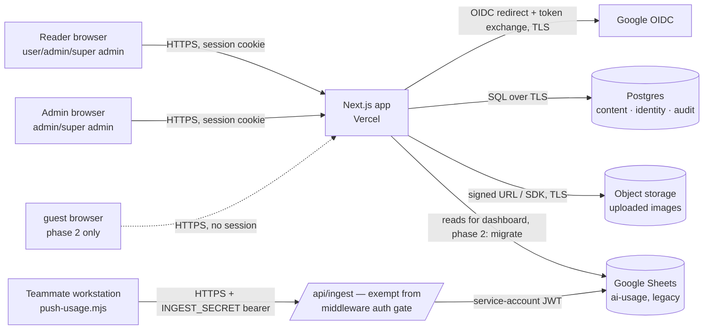

# Threat Model — Coc Docs Platform

> **Authoring skill**: `03-draft-dev-plan` (design phase, before G2)
> **Lead**: `architect` / **Author of this document**: `security-auditor`
> **Methodology**: STRIDE + attack surface analysis
> **Date**: 2026-09-08
> **Update triggers**: Architecture changes, new external channels, new PII processing (record changes via ADR)
> **Status**: DRAFT — awaiting G2

---

## 0. How to Read This Document

MVP ships entirely behind login (CONST-OPS-03 posture continued; FR-PUBLIC-001 is `Won't`). Two threat populations are therefore kept explicit throughout:

- **MVP** — reachable now, with `guest` access not enforced. These are the threats that gate G2/G3.
- **Phase 2** — only reachable once `guest` reading and/or the `idea` doc set are exposed (RISK-009, RISK-010, BR-026). These are recorded so the phase-2 design does not have to redo this analysis, but they do **not** block this project's gates.

Every threat row carries a mitigation; every mitigation cites an ADR or an NFR-SEC/FR requirement ID. There are zero orphan threats — see §5 DoD.

---

## 1. Scope / Trust Boundaries

**Systems/components under analysis**: Next.js 15 (App Router) app on Vercel, serving both the reader site and the admin console; Postgres (Neon/Supabase) as the content, identity and audit store; object storage for uploaded images; Google OIDC as the identity provider; the retained `/api/ingest` endpoint writing to Google Sheets.

**Assets to protect**:
- Account PII: name, email (FR-AUTH; NFR-SEC-PII)
- ai-usage PII: per-teammate email + token usage, keyed `(user_email, date)` (NFR-SEC-PII, RISK-010)
- Audit trail integrity (FR-OPS-001..003, NFR-OPS-AUDIT)
- Session tokens / OIDC tokens (NFR-SEC-SESSION)
- Content integrity (page bodies, navigation order) — the product itself
- `INGEST_SECRET` (NFR-SEC-CHANNEL)
- Uploaded media (RISK-006)
- The `idea` doc set's internal-portfolio content (RISK-009, BR-026) — a **confidentiality** asset only relevant once phase 2 is in scope

**Trust boundaries identified**:

| # | Boundary | Description |
|---|---|---|
| TB-1 | Internet ↔ Vercel edge/app | Browser traffic (readers + admins) terminates TLS at Vercel |
| TB-2 | Vercel app ↔ Google OIDC | Outbound auth handshake, inbound ID token |
| TB-3 | Vercel app ↔ Postgres | Application queries/writes content, identity, roles, audit, sessions |
| TB-4 | Vercel app ↔ Object storage | Upload/read of media binaries |
| TB-5 | Vercel app ↔ Google Sheets (`/api/ingest`) | Legacy machine-to-machine ingest path, bearer-secret authenticated |
| TB-6 | `guest`/`user` role ↔ `admin`/`super admin` role | Intra-application privilege boundary enforced by the role ladder, not a network boundary — included because FR-AUTH-005/006/008 make it a first-class control point |
| TB-7 (phase 2 only) | Internet ↔ public reader pages, no session | Anonymous access boundary; does not exist in MVP |

### Data Flow Diagram (DFD) Overview

> Every flow above crosses at least one trust boundary in the table and is in scope for §2.

---

## 2. STRIDE Threat Analysis

Legend: **Phase** = MVP or P2 (phase 2 only). CVSS vectors use v3.1 base metrics.

| ID | Component/Flow | STRIDE | Threat Scenario | Phase | Impact | CVSS v3.1 (vector) | Mitigation | Linked ADR / REQ |
|----|--------------|--------|--------------|------|------|------|--------|----------------|
| TM-001 | TB-1/TB-2 Google sign-in | **S**poofing | Attacker forges or replays an ID token / session cookie to impersonate a user | MVP | High — full account takeover | 8.1 (`AV:N/AC:H/PR:N/UI:N/S:U/C:H/I:H/A:N`) | Server-side OIDC token verification (signature, audience, issuer, nonce), `httpOnly`+`secure`+`sameSite=lax` session cookie signed server-side, no client-readable session secret | ADR-008, ADR-011, NFR-SEC-AUTH, FR-AUTH-001 |
| TM-002 | TB-1 session cookie | **S**poofing | Session fixation or cookie theft via XSS (see TM-010) is used to hijack an authenticated session | MVP | High | 7.5 (`AV:N/AC:L/PR:N/UI:N/S:U/C:H/I:L/A:N`) — assumes XSS is otherwise mitigated; combined score with TM-010 unmitigated would be higher | Regenerate session on login; `httpOnly` prevents JS read; 1-day TTL bounds exposure window; sanitisation (TM-010) removes the primary theft vector | ADR-011, NFR-SEC-SESSION |
| TM-003 | TB-3 role/session check | **S**poofing | A caller forges its own role claim (e.g. client-supplied header/param) to appear as `admin` | MVP | High | 8.8 (`AV:N/AC:L/PR:L/UI:N/S:U/C:H/I:H/A:N`) | Role is read server-side from the DB-backed session/user record on every request, never trusted from client input; enforced in middleware, not per-page | ADR-011, FR-AUTH-005 |
| TM-004 | TB-5 `/api/ingest` | **S**poofing | The single shared `INGEST_SECRET` leaks (workstation, log, git) and is reused to impersonate any teammate's usage push, or reused as a template for a new editorial write endpoint | MVP | High if reused elsewhere; Medium in current scope (writes only to Sheets, no editorial authority) | 6.5 (`AV:N/AC:L/PR:N/UI:N/S:U/C:N/I:H/A:N`) for the ingest path itself; explicitly called out because reuse elsewhere would push this to ≥ 8 | Secret remains scope-limited to `/api/ingest` only; explicitly forbidden as a pattern for any editorial write path (NFR-SEC-CHANNEL); rotation runbook define 90-day interval | ADR-011, NFR-SEC-CHANNEL, `security/runbook-key-rotation.md` |
| TM-005 | TB-6 admin→account-mgmt | **T**ampering / **E**oP | An `admin` account calls the account-management API directly (bypassing UI) to create/promote an account | MVP | High | 8.8 (`AV:N/AC:L/PR:L/UI:N/S:U/C:H/I:H/A:N`) | Server-side authorization check on every account-management route requires `super admin`, independent of which UI route is used; negative test FR-AUTH-008 | ADR-011, FR-AUTH-008 |
| TM-006 | TB-3 page write | **T**ampering | Concurrent admin edits silently overwrite each other's changes | MVP | Medium — content integrity, no confidentiality/availability loss | 4.3 (`AV:N/AC:L/PR:L/UI:N/S:U/C:N/I:L/A:N`) | Optimistic locking: version/timestamp check on save, second writer warned and blocked from silent overwrite | FR-CONT-013 |
| TM-007 | TB-3 page write | **T**ampering | A malicious/compromised `admin` account plants a hostile block (e.g. crafted `tree`/`footerHtml`/embed content) that executes when rendered to other readers | MVP | High | 8.0 (`AV:N/AC:L/PR:L/UI:R/S:C/C:L/I:H/A:N`) — stored XSS via a legitimately authenticated but malicious/compromised author account | Sanitisation applies uniformly regardless of author trust level — see TM-010; audit trail (FR-OPS-001) provides attribution and detection after the fact | ADR-011, NFR-SEC-SANITIZE, FR-OPS-001 |
| TM-008 | TB-3 audit trail | **R**epudiation | An `admin` denies having made a change; or an attacker with DB write access deletes/edits audit rows to cover tracks | MVP | Medium — accountability loss, not data loss | 6.5 (`AV:N/AC:L/PR:H/UI:N/S:U/C:N/I:H/A:N`) | Audit entries are append-only at the application layer (no UPDATE/DELETE code path), record actor+action+target+timestamp on every content change (FR-OPS-001), retained ≥ 1 year (NFR-OPS-AUDIT); DB-level append-only enforcement (e.g. revoked UPDATE/DELETE grants on the audit table for the app role) recommended as a follow-up, not required for MVP given the single-developer operating model | ADR-006, FR-OPS-001, NFR-OPS-AUDIT |
| TM-009 | TB-1/TB-3 failed logins | **R**epudiation | Failed sign-in / permission-denied events are not recorded, so brute-force or probing attempts leave no trace | MVP | Low-Medium | 5.3 (`AV:N/AC:L/PR:N/UI:N/S:U/C:N/I:N/A:L`) — availability of forensic record, not the system itself | Failed sign-ins and permission-denied events logged per FR-OPS-002 | ADR-006, FR-OPS-002 |
| TM-010 | TB-1 rendered content | **I**nfo Disclosure / RCE-in-browser | Stored XSS: the 15 content modules' `.tree`, `pre.copyable` and `footerHtml` patterns use `dangerouslySetInnerHTML`. Once authorship moves from one trusted developer to multiple non-technical `admin`s, unescaped HTML becomes attacker-reachable through the ordinary editing UI — an admin (malicious, compromised, or merely careless with a pasted snippet) can inject `<script>`, inline event handlers, or `javascript:` URLs that execute in every subsequent reader's session, enabling session-cookie theft (chains into TM-002), credential-relay phishing, or defacement | MVP | High | 8.0 (`AV:N/AC:L/PR:L/UI:R/S:C/C:L/I:H/A:N`) — stored, authenticated-attacker XSS affecting other users' sessions (scope changed) | Server-side sanitisation of all rich-content fields before storage AND before render (defence in depth) using an allowlist HTML sanitiser (not a denylist/regex); the block schema restricts free-HTML fields to specifically the `tree`/`copyable-code`/`footerHtml`-equivalent block types, each with its own narrow allowlist rather than one generic "raw HTML" block type; embed blocks (Tier B) resolve to a fixed component identifier, never to arbitrary markup | ADR-011, NFR-SEC-SANITIZE, RISK-005 |
| TM-011 | TB-4 media upload | **T**ampering / **I**nfo Disclosure | An admin (or a compromised admin session) uploads a file whose declared type doesn't match its actual content (e.g. an `.svg` containing `<script>`, or a polyglot file), which is then served back to readers and executes in their browser, or uploads an oversized/malicious file to exhaust storage | MVP | Medium-High | 7.4 (`AV:N/AC:L/PR:L/UI:R/S:C/C:N/I:L/A:L`) | Validate declared type, sniffed/actual content type, and size before accept; store outside any executable path; serve with `Content-Disposition` and a restrictive `Content-Security-Policy`/`X-Content-Type-Options: nosniff`; SVG specifically either rejected or sanitised (SVG can carry script) | ADR-011, NFR-SEC-UPLOAD, FR-MEDIA-004, RISK-006 |
| TM-012 | TB-4 media storage | **E**oP | Object storage bucket/keys misconfigured as public-write or public-list, allowing unauthenticated upload or enumeration of other admins' assets | MVP | Medium | 6.5 (`AV:N/AC:L/PR:N/UI:N/S:U/C:L/I:N/A:N`) | Bucket access restricted to server-issued signed URLs/credentials only; no public write; unpredictable object keys | ADR-011, NFR-SEC-UPLOAD |
| TM-013 | TB-3 PII columns | **I**nfo Disclosure | ai-usage rows (`user_email`, per-teammate token counts) or account PII (name, email) are readable by a role below the intended tier, e.g. a `user` querying another user's usage row directly | MVP | Medium — internal PII, not financial | 6.5 (`AV:N/AC:L/PR:L/UI:N/S:U/C:H/I:N/A:N`) | Row/query-level authorization: `user` scoped to own `(user_email)` rows only; `admin`/`super admin` see all; enforced server-side in the query layer, never by client-side filtering | ADR-005, NFR-SEC-PII, BR-020 |
| TM-014 | TB-3 DB at rest | **I**nfo Disclosure | Database backup, snapshot, or a leaked connection string exposes PII in plaintext to whoever obtains it | MVP | Medium | 5.9 (`AV:N/AC:H/PR:N/UI:N/S:U/C:H/I:N/A:N`) | Provider-native encryption at rest (Neon/Supabase both encrypt storage by default); connection string held only in Vercel environment variables, never committed; column-level application encryption evaluated and explicitly scoped out for MVP — see ADR-005 for the proportionality argument | ADR-005, NFR-SEC-PII |
| TM-015 | TB-3 `/api/ingest` write | **T**ampering | Malformed or spoofed usage payload corrupts the `(user_email, date)` upsert, polluting another teammate's usage record | MVP | Low | 4.3 (`AV:N/AC:L/PR:L/UI:N/S:U/C:N/I:L/A:N`) | Existing bearer-secret gate retained (unchanged from AS-IS) plus schema validation of the payload on write; explicitly out of scope for redesign since FR-USAGE-001 is `Won't` | NFR-SEC-CHANNEL |
| TM-016 | TB-1/TB-3 all app routes | **D**oS | Volumetric or credential-stuffing traffic against the login or read endpoints degrades service for internal users | MVP | Low-Medium — no uptime SLA committed (NFR-AVAIL-01) | 5.3 (`AV:N/AC:L/PR:N/UI:N/S:U/C:N/I:N/A:L`) | Vercel platform-level rate limiting/edge protections (default); no bespoke WAF built for MVP — proportionate given best-effort availability posture and internal audience; NFR-AVAIL-02 (cache-served reads during DB outage) is the meaningful mitigation for the realistic failure mode (DB unavailability), not attacker-driven DoS | NFR-AVAIL-02 |
| TM-017 | TB-3 DB unavailability | **D**oS | Postgres becomes unavailable; because pages are now DB-backed (unlike the AS-IS static build), reader pages go down where they previously would not have | MVP | Medium — availability regression vs. AS-IS, explicitly flagged in requirements | 5.3 (`AV:N/AC:L/PR:N/UI:N/S:U/C:N/I:N/A:L`) — self-inflicted architectural regression, not an external attack, scored for completeness | Reader pages served from cache (ISR/ revalidate) during brief DB unavailability per NFR-AVAIL-02 | NFR-AVAIL-02 |
| TM-018 | TB-6 admin vs. super admin | **E**oP | An `admin` account attempts to reach account-management functionality (create account, assign role) that should be `super admin`-only | MVP | High | 8.1 (`AV:N/AC:H/PR:L/UI:N/S:U/C:H/I:H/A:N`) | Explicit negative security test (FR-AUTH-008); server-side role gate on every account-management route, not just UI hiding | ADR-011, FR-AUTH-008 |
| TM-019 | TB-6 unauthenticated → any role | **E**oP | A request with no valid session reaches a role-gated route because a route is missing from the middleware gate (the known failure pattern already present in AS-IS via `/api/ingest`'s deliberate exemption) | MVP | High | 8.8 (`AV:N/AC:L/PR:N/UI:N/S:U/C:H/I:H/A:N`) | Default-deny middleware: every route requires a minimum role unless explicitly and individually allowlisted (mirroring how `/api/ingest`'s exemption is today deliberate and documented, not accidental); allowlist reviewed at each PR touching routing | ADR-011, FR-AUTH-005, FR-AUTH-006 |
| TM-020 (P2) | TB-7 public reader pages | **I**nfo Disclosure | Once `guest` reading ships, the `idea` doc set (if not withheld) discloses 9 internal system names, environment IDs, config filenames, debug ports, Tomcat versions and workspace paths to the public internet | Phase 2 | High for a banking/insurance-adjacent organisation | 5.3 (`AV:N/AC:L/PR:N/UI:N/S:U/C:L/I:N/A:N`) base — information disclosure of internal architecture details, not credentials or direct system access; organisational/reputational severity is higher than the technical CVSS reflects | BR-026 mandates an explicit human disclosure decision per page/doc-set before any page becomes `guest`-visible; default is **withheld**, not published-by-omission | BR-026, RISK-009 — **not an MVP blocker**; tracked for the phase-2 threat model refresh |
| TM-021 (P2) | TB-7 public reader pages | **I**nfo Disclosure | ai-usage PII (teammate emails, token usage) becomes reachable if the dashboard route is inadvertently included in the `guest`-visible set | Phase 2 | High | 7.5 (`AV:N/AC:L/PR:N/UI:N/S:U/C:H/I:N/A:N`) | ai-usage routes are excluded from the `guest` minimum-role default by construction (minimum role ≥ `user`); phase-2 rollout checklist must explicitly verify no PII route's minimum role was left at `guest` | BR-026, NFR-SEC-PII, RISK-010 — **not an MVP blocker** |
| TM-022 (P2) | TB-7 anonymous traffic | **D**oS | With no login wall, anonymous scraping/crawling volume rises relative to MVP's login-gated traffic | Phase 2 | Low | 3.7 (`AV:N/AC:L/PR:N/UI:N/S:U/C:N/I:N/A:L`) | Deferred to phase-2 architecture review alongside `robots.ts`/`sitemap.ts` reversal | Not an MVP blocker; revisit in phase-2 threat model |

> All 6 STRIDE categories reviewed for every trust-boundary-crossing flow: ✅ (Spoofing: TM-001..004; Tampering: TM-005..007, 011, 015; Repudiation: TM-008, 009; Info Disclosure: TM-010, 013, 014, 020, 021; DoS: TM-016, 017, 022; EoP: TM-005, 018, 019).

---

## 3. Attack Surface

| Surface | Exposure | AuthN/AuthZ | Input Validation | Notes |
|------|------|-----------|-----------|------|
| Reader pages (`/{lang}/docs/...`) | MVP: internal, behind login. Phase 2: public internet | Session cookie, role ≥ page's minimum role, checked server-side (FR-AUTH-006) | Slug/locale params validated against known set; unknown → styled 404 (FR-READ-004) | Rendering path is where TM-010 (sanitisation) lands |
| Admin console (`/admin/...`) | Internal, behind login | Session cookie, role ≥ `admin` (account mgmt further gated to `super admin`) | All content-block fields validated against the block schema server-side, not just client-side | Primary target for TM-005 through TM-011 |
| `/api/ingest` | Internet-reachable, exempt from middleware auth gate by design | Single shared bearer secret (`INGEST_SECRET`) | Payload schema validation on `(user_email, date, usage)` | Explicitly NOT a template for any new write path (NFR-SEC-CHANNEL); retained as-is, not redesigned |
| Media upload endpoint | Internal, behind login, role ≥ `admin` | Session cookie + role check | Declared MIME type + sniffed content type + size ceiling; SVG rejected or sanitised; stored under non-executable, unpredictable keys | New surface — zero images exist today, no legacy pattern to inherit (RISK-006) |
| Google OIDC callback | Internet-reachable (required for the auth flow itself) | State/nonce validated; ID token signature/audience/issuer verified server-side | N/A (protocol-level) | Standard OIDC library usage (`google-auth-library` already a dependency) |
| Postgres | Not internet-exposed; reached only from the Vercel app via connection string | Network-level (provider-managed, TLS-required connection) + app-level DB role with least privilege | Parameterised queries / ORM — no raw string concatenation | Provider-native encryption at rest |
| Object storage | Not directly internet-writable; reads may be via signed URL or CDN | Signed URLs for upload; read access scoped to what the app needs to serve | Content-type + size checked before signed URL issuance/on upload confirm | See TM-011, TM-012 |

---

## 4. Unresolved Threats / Residual Risk

| ID | Threat | Current Status | Residual Risk | Decision (Accept/Mitigate/Transfer) | Approval |
|----|------|----------|-----------|---------------------|------|
| TM-004 | `INGEST_SECRET` is a single shared, long-lived secret with no per-editor identity or revocation short of full rotation | MITIGATED (scope-limited) — not eliminated | L (current scope) / would be H if ever reused as a write-path template | **Accept** for MVP: retained unchanged from AS-IS, explicitly fenced off from editorial paths; rotation on a 90-day cadence per the key-rotation runbook | PM |
| TM-008 | Audit log integrity relies on application-layer append-only discipline, not DB-enforced immutability | MITIGATED (partial) | L — proportionate to a single part-time developer operating model; no external compliance regime currently mandates tamper-evident logs (§7 BUSINESS-REQUIREMENTS: regulatory scope TBD) | **Accept** for MVP; **Mitigate** (DB-level append-only grant, or a write-once log sink) recommended if/when the platform enters a regulated scope in phase 2 | PM |
| TM-014 | No column-level encryption for PII at rest; relies on provider-managed encryption at rest | MITIGATED (provider-level) | L — internal PII (names, emails, usage counts), not financial/health data; provider encryption covers the realistic threat (stolen disk/backup) | **Accept** for MVP — see ADR-005 §4.2 for why column-level encryption is judged disproportionate here | PM |
| TM-020, TM-021, TM-022 | Phase-2 public-exposure threats | OPEN — by design, deferred | H (TM-020, TM-021) / L (TM-022) if phase 2 ships without re-review | **Mitigate before phase 2**: BR-026 human disclosure decision is a hard gate; this threat model must be refreshed before any `guest`-visibility change ships | PM / whoever holds phase-2 sign-off |
| TM-016 | No bespoke rate limiting/WAF beyond Vercel platform defaults | ACCEPTED | L — best-effort availability posture (NFR-AVAIL-01), internal audience, no uptime SLA | **Accept** for MVP | PM |

**All threats scoring CVSS ≥ 7.0 in §2 (TM-001, TM-003, TM-005, TM-007, TM-010, TM-011, TM-018, TM-019) have an assigned mitigation above — none are left as accepted residual risk at that severity.**

### 4.1 What "blocking" means at G2 versus G3 — clarification by `architect`

> **Added by the lead agent when consolidating (2026-09-08).** As originally written, the closing note above said these threats were *"G2/G3-blocking until their linked ADR/REQ is implemented and verified"*. Read literally that blocks G2 permanently, because implementation happens in Skill 4 — **after** G2. No design gate could ever pass under that reading. Skill 03 §3.5's actual wording is that ***unresolved*** threats at CVSS ≥ 7.0 are blocking, so the test differs by gate:

| Gate | Question asked of a CVSS ≥ 7.0 threat | Status of the 8 threats |
|---|---|---|
| **G2** (design) | Is there a **designed mitigation**, traceable to an accepted ADR or a specified requirement? | ✅ **Satisfied.** All 8 map to ADR-011 and to numbered NFR-SEC requirements. None is unaddressed. |
| **G3** (release) | Is that mitigation **implemented and verified by test**? | ⏳ **Not yet — and correctly so.** No code exists. This is what Sprints 1–7 and TEST-PLAN §5 are for. |

**Therefore: these 8 threats do not block G2. They do block G3** until the corresponding security tests pass.

Verification ownership is explicit so nothing falls between the gates:

| Threat | Mitigation designed in | Verified by |
|---|---|---|
| TM-001, TM-003, TM-005 | ADR-011 (auth, session, role enforcement) | Sprint 5 · TEST-PLAN §5 negative tests, incl. FR-AUTH-008 |
| TM-007, TM-010 | ADR-010 §3 (no raw-HTML block) + ADR-011 (allowlist sanitisation) | Sprint 5 · TEST-PLAN §5 XSS suite |
| TM-011, TM-018 | ADR-011 (three-signal upload validation) | Sprint 4 · TEST-PLAN §5 upload suite |
| TM-019 | ADR-011 + ADR-003 (authorisation on write paths) | Sprint 3 and 5 · integration tests |

The residual-risk acceptances in the table above (TM-004, TM-008, TM-014, TM-016) are separate: those are **accepted**, not deferred, and each carries a stated proportionality rationale and a PM approval column that still needs a signature.

---

## 5. Definition of Done (DoD)

- [x] All 6 STRIDE categories reviewed for every trust-boundary-crossing flow (see §2 coverage note)
- [x] Every threat mapped to a mitigation + linked ADR/REQ — zero orphan threats (every TM-row in §2 carries a non-empty "Linked ADR / REQ" cell)
- [x] Attack surface table completed (authentication and input validation specified) — §3
- [x] Residual risks decided as accept/mitigate, pending PM approval signature — §4
- [x] Threats at CVSS ≥ 7.0 tied to G2/G3 blocking conditions — see §4 closing note
- [x] MVP vs. phase-2 threats distinguished throughout (§0, §2 Phase column)

---

## Change History

| Date | Version | Changes | Author |
|------|------|------|--------|
| 2026-09-08 | 1.0 | Initial threat model for Skill 3 / G2 | security-auditor |

---

**Review**

| Date | Reviewer | Comments | Status |
|------|--------|------|------|
| 2026-09-08 | security-auditor | Authored per CONST-SEC-01 trigger; zero orphan threats verified; 8 threats at CVSS ≥ 7.0, all mapped to ADR-011 controls | DRAFT — awaiting PM/G2 |
