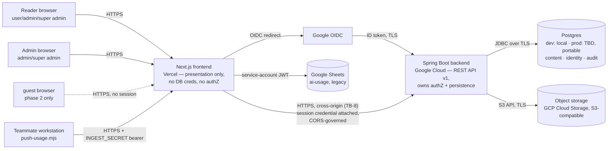

# Threat Model — Coc Docs Platform

> **Authoring skill**: `03-draft-dev-plan` (design phase, before G2)
> **Lead**: `architect` / **Author of this document**: `security-auditor`
> **Methodology**: STRIDE + attack surface analysis
> **Date**: 2026-09-08 (v1.0) · **Revised**: 2026-09-09 (v1.1)
> **Update triggers**: Architecture changes, new external channels, new PII processing (record changes via ADR)
> **Status**: DRAFT — awaiting G2 re-approval (G2 was reverted to pending by ADR-012; see revision note below)

---

> **Revision note (2026-09-09)**: This revision is triggered by [ADR-012](adr/ADR-012-revision-of-001-backend-stack.md), which splits the single Next.js application into two services — a Next.js **frontend** (presentation only, `CONST-TECH-05`) and a Java 21 / Spring Boot 3.4 **backend** (owns persistence, authorisation and business rules, `CONST-TECH-06`) — and settles hosting as Google Cloud (`ADR-012 §2.1`). This introduces a trust boundary that did not exist before: **TB-8, frontend ↔ backend**. All existing threat IDs (TM-001…TM-022) are preserved unchanged in numbering; two are re-scored (TM-003, TM-018) because the boundary split changes their exploitability, and eight new threats (TM-023…TM-030) are added for TB-8 and for the team-size change (1 → 6 developers, `ADR-012` context). See the Change History at the foot of this document for the full diff summary.

---

## 0. How to Read This Document

MVP ships entirely behind login (CONST-OPS-03 posture continued; FR-PUBLIC-001 is `Won't`). Two threat populations are therefore kept explicit throughout:

- **MVP** — reachable now, with `guest` access not enforced. These are the threats that gate G2/G3.
- **Phase 2** — only reachable once `guest` reading and/or the `idea` doc set are exposed (RISK-009, RISK-010, BR-026). These are recorded so the phase-2 design does not have to redo this analysis, but they do **not** block this project's gates.

The two-service split (below) does **not** change this MVP/phase-2 split — TB-8 and its threats (TM-023…TM-027, TM-029, TM-030) are all **MVP**, because the frontend↔backend boundary exists from the first line of backend code, not from phase 2 onward. TM-028 (credential sprawl) is likewise MVP, since the team is already six people.

Every threat row carries a mitigation; every mitigation cites an ADR or an NFR-SEC/FR/CONST requirement ID. There are zero orphan threats — see §5 DoD.

---

## 1. Scope / Trust Boundaries

**Systems/components under analysis** (revised for the two-service architecture, ADR-012):

- **Frontend**: Next.js 15 (App Router) on Vercel — presentation only. No database credentials, no authorisation enforcement (`CONST-TECH-05`). Serves both the reader site and the admin console UI, but every data-carrying action is a call to the backend.
- **Backend**: Java 21 / Spring Boot 3.4 on **Google Cloud** (`ADR-012 §2.1`) — owns all persistence, authorisation and business rules, and exposes a versioned REST API described by an OpenAPI contract (`CONST-TECH-06`, `CONST-TECH-07`).
- **Postgres** — development: local PostgreSQL 15+ (`ADR-012 §2.2`); production: provider open but portable, decided pre-deployment, not pre-commit (`CONST-TECH-08`, `ADR-012 §2.3`). Reached only from the backend, never the frontend.
- **Object storage** — behind the S3 API; on Google Cloud this is Cloud Storage's S3-compatible interface (`ADR-012 §2.4`). Reached only from the backend, which issues time-limited, scope-limited signed URLs.
- **Google OIDC** as identity provider; ID-token verification is now a backend responsibility (`ADR-012` Decision 4).
- The retained `/api/ingest` endpoint (bearer-secret authenticated, writes to Google Sheets). **Confirmed by `architect`, 2026-09-09: this endpoint stays in the FRONTEND, unmoved.** `FR-USAGE-001` is `Won't` for MVP and `lib/usage/*` is untouched Next.js code, so relocating it would be scope that serves no stated driver. See the documented exception below.

> **Documented exception to `CONST-TECH-05`.** The rule is that the frontend holds no database credentials and enforces no authorisation. `/api/ingest` is a **pre-existing, scope-limited breach of that rule**: it is a Next.js route handler holding a Google Sheets service-account credential and a shared bearer secret.
>
> It is recorded as an exception rather than quietly tolerated, because pretending the frontend is credential-free when it is not would make every later reasoning about that boundary wrong. Three things bound it:
> 1. It writes **only** to Google Sheets — no access to Postgres, content, accounts or the audit trail.
> 2. It is **explicitly forbidden as a pattern** for any editorial write path (`NFR-SEC-CHANNEL`). No new frontend endpoint may hold a credential.
> 3. It is **out of MVP scope entirely** — no work is planned on it, so the surface does not grow.
>
> If `FR-USAGE-001` is ever promoted out of `Won't`, this exception closes and the endpoint moves to the backend with the rest of the write paths.

**Assets to protect** (additions in **bold**):

- Account PII: name, email (FR-AUTH; NFR-SEC-PII)
- ai-usage PII: per-teammate email + token usage, keyed `(user_email, date)` (NFR-SEC-PII, RISK-010)
- Audit trail integrity (FR-OPS-001..003, NFR-OPS-AUDIT)
- Session tokens / OIDC tokens (NFR-SEC-SESSION)
- **The session/API credential in transit across the new frontend↔backend origin boundary** (NFR-SEC-SESSION, `CONST-TECH-05` — new asset introduced by the boundary split)
- Content integrity (page bodies, navigation order) — the product itself
- `INGEST_SECRET` (NFR-SEC-CHANNEL)
- **GCP service-account credentials / IAM identities** (new with hosting decision, `ADR-012 §2.1`)
- Uploaded media (RISK-006)
- The `idea` doc set's internal-portfolio content (RISK-009, BR-026) — a **confidentiality** asset only relevant once phase 2 is in scope

**Trust boundaries identified**:

| # | Boundary | Description |
|---|---|---|
| TB-1 | Internet ↔ Frontend (Next.js, Vercel edge/app) | Browser traffic (readers + admins) terminates TLS at Vercel. Unchanged from AS-IS. |
| TB-2 | Frontend/Browser ↔ Google OIDC | Outbound auth handshake, inbound ID token. **Verification** of the ID token (signature, audience, issuer, nonce) now happens **backend-side** (`ADR-012` Decision 4), even though the browser's redirect dance still touches the frontend origin. |
| TB-3 | **Backend** ↔ Postgres | **Moved from the frontend to the backend.** Application queries/writes content, identity, roles, audit, sessions. The frontend holds no DB credentials at all (`CONST-TECH-05`). |
| TB-4 | **Backend** ↔ Object storage | **Moved from the frontend to the backend.** Backend issues signed, time-limited, scope-limited upload/read URLs; raw bytes may still flow browser↔storage directly once a URL is issued — that remains backend-governed, not a frontend credential. |
| TB-5 | **Frontend** ↔ Google Sheets (`/api/ingest`) | Legacy machine-to-machine ingest path, bearer-secret authenticated. **Confirmed 2026-09-09: remains in the frontend, unmoved** — `FR-USAGE-001` is `Won't`, so `lib/usage/*` is untouched. This is the one documented exception to `CONST-TECH-05` (see the scope note above): a frontend route handler that does hold a credential. Bounded by writing only to Sheets, being forbidden as a pattern for editorial writes, and having no planned work. |
| TB-6 | `guest`/`user` role ↔ `admin`/`super admin` role | Intra-application privilege boundary — **now enforced exclusively in the Spring backend's service layer (`CONST-TECH-07`)**. Not a network boundary. Unlike the single-service design, there is no longer any sense in which the frontend could be assumed to also be checking this — it is architecturally incapable of enforcing it. |
| **TB-8 (NEW, MVP)** | **Frontend ↔ Backend, cross-origin** | **The boundary that did not exist before the two-service split.** Every page render and every admin action now crosses an origin boundary to reach the API (`ADR-012` Decision 1). Carries the session/API credential, is subject to CORS policy and cookie `SameSite` behaviour, and is the surface for contract-level attacks — mass assignment, over-posting, IDOR/BOLA on API endpoints the UI itself would never construct — that a same-origin, server-rendered app never exposed as a discrete network hop. Full STRIDE treatment in §2. |
| TB-7 (phase 2 only) | Internet ↔ public reader pages, no session | Anonymous access boundary; does not exist in MVP. Unchanged by the service split — still terminates at the frontend, which still calls the backend on the reader's behalf. |

### Data Flow Diagram (DFD) Overview

> Every flow above crosses at least one trust boundary in the table and is in scope for §2. The frontend→backend arrow is TB-8 and is new relative to v1.0 of this document.

---

## 2. STRIDE Threat Analysis

Legend: **Phase** = MVP or P2 (phase 2 only). CVSS vectors use v3.1 base metrics. Rows marked **RE-SCORED** changed score because of the two-service boundary split (ADR-012); rows marked **(TB-8)** are new in this revision.

| ID | Component/Flow | STRIDE | Threat Scenario | Phase | Impact | CVSS v3.1 (vector) | Mitigation | Linked ADR / REQ |
|----|--------------|--------|--------------|------|------|------|--------|----------------|
| TM-001 | TB-1/TB-2 Google sign-in | **S**poofing | Attacker forges or replays an ID token / session cookie to impersonate a user | MVP | High — full account takeover | 8.1 (`AV:N/AC:H/PR:N/UI:N/S:U/C:H/I:H/A:N`) | Server-side (backend) OIDC token verification (signature, audience, issuer, nonce), `httpOnly`+`secure`+`sameSite` session cookie signed server-side, no client-readable session secret. Verification now happens in the Spring backend rather than the Next.js app (`ADR-012` Decision 4) — same control, relocated | ADR-008, ADR-011, NFR-SEC-AUTH, FR-AUTH-001 |
| TM-002 | TB-1 session cookie | **S**poofing | Session fixation or cookie theft via XSS (see TM-010) is used to hijack an authenticated session | MVP | High | 7.5 (`AV:N/AC:L/PR:N/UI:N/S:U/C:H/I:L/A:N`) — assumes XSS is otherwise mitigated; combined score with TM-010 unmitigated would be higher | Regenerate session on login; `httpOnly` prevents JS read regardless of which origin issued the cookie; 1-day TTL bounds exposure window; sanitisation (TM-010) removes the primary theft vector. Cookie is now issued by the backend and consumed cross-origin (TB-8) — `httpOnly` protection is unaffected by that, since it is enforced by the browser, not by which service set the cookie | ADR-011, NFR-SEC-SESSION |
| TM-003 | TB-3 role/session check — **now also TB-8**, since the check must hold when the backend is called directly, not only via the frontend | **S**poofing | A caller forges its own role claim (e.g. client-supplied header/param) to appear as `admin`. **RE-SCORED 2026-09-09**: previously this check lived inside the same Next.js deployment as session issuance, so reaching it at all implied a session already existed for that origin. The backend is now a directly-reachable, independently-versioned, OpenAPI-published REST API (`ADR-012` Decision 1) that any caller can hit without any prior interaction with the frontend — the worst-case reachability for an implementation that (mis)trusts a client-supplied identity header/claim is therefore an **unauthenticated** caller, not merely a low-privileged one (`PR:L`→`PR:N`). A successfully forged `super_admin` claim also reaches account deactivation (FR-AUTH-003), which is a **platform-wide availability** impact on legitimate users, not only a confidentiality/integrity issue scoped to the attacker's own account (`A:N`→`A:H`) | MVP | Critical — full privilege escalation with platform-wide availability impact | **9.8** (`AV:N/AC:L/PR:N/UI:N/S:U/C:H/I:H/A:H`) — **changed from 8.8** (`AV:N/AC:L/PR:L/UI:N/S:U/C:H/I:H/A:N`); see rationale in the Threat Scenario cell | Role is read server-side from the DB-backed session/token on **every request the backend receives, regardless of caller** (browser via frontend, direct API client, or any other origin) — never trusted from client input; enforced in the Spring Security filter chain (default-deny), not per-controller-method. The frontend's inability to enforce anything (`CONST-TECH-07`) is the design's starting assumption, not a residual gap | ADR-011 §2 (revised, cross-service section), ADR-012 Decision 4, FR-AUTH-005, CONST-TECH-07 |
| TM-004 | TB-5 `/api/ingest` | **S**poofing | The single shared `INGEST_SECRET` leaks (workstation, log, git) and is reused to impersonate any teammate's usage push, or reused as a template for a new editorial write endpoint. **Likelihood note (2026-09-09)**: the team grew from 1 part-time developer to 6 — more workstations, more `.env`/config copies, more chat/doc shares that could hold this secret. This does not change the CVSS base score (the vulnerability's mechanics are unchanged) but materially raises the probability of the leak scenario occurring — see TM-028 for the generalised version of this concern across all secrets, not just this one | MVP | High if reused elsewhere; Medium in current scope (writes only to Sheets, no editorial authority) | 6.5 (`AV:N/AC:L/PR:N/UI:N/S:U/C:N/I:H/A:N`) for the ingest path itself; explicitly called out because reuse elsewhere would push this to ≥ 8 | Secret remains scope-limited to `/api/ingest` only; explicitly forbidden as a pattern for any editorial write path (NFR-SEC-CHANNEL); rotation runbook defines a 90-day interval. **Revised for team scale**: secret is stored in a centralised secret manager (GCP Secret Manager, per ADR-011's new team-scale section) rather than passed around as a local `.env` value, so a 6-person team never has 6 independent copies to leak | ADR-011 §2 (team-scale section), NFR-SEC-CHANNEL, `security/runbook-key-rotation.md` |
| TM-005 | TB-6 admin→account-mgmt — **the literal, default call path via TB-8**, not a UI bypass | **T**ampering / **E**oP | An `admin` account calls the account-management API directly (bypassing the frontend UI) to create/promote an account. **Note (2026-09-09)**: with the two-service split, "calling the API directly" is no longer a hypothetical bypass — it is exactly how the legitimate frontend itself behaves, and any other client can do the same over TB-8. The mitigation must not assume a request "came through the UI" | MVP | High | 8.8 (`AV:N/AC:L/PR:L/UI:N/S:U/C:H/I:H/A:N`) | Server-side (backend) authorization check on every account-management route requires `super admin`, independent of which UI or client issued the request; negative test FR-AUTH-008 | ADR-011, FR-AUTH-008 |
| TM-006 | TB-3 page write | **T**ampering | Concurrent admin edits silently overwrite each other's changes | MVP | Medium — content integrity, no confidentiality/availability loss | 4.3 (`AV:N/AC:L/PR:L/UI:N/S:U/C:N/I:L/A:N`) | Optimistic locking: version/timestamp check on save, second writer warned and blocked from silent overwrite. Enforced in the backend, the sole writer of record | FR-CONT-013 |
| TM-007 | TB-3 page write | **T**ampering | A malicious/compromised `admin` account plants a hostile block (e.g. crafted `tree`/`footerHtml`/embed content) that executes when rendered to other readers | MVP | High | 8.0 (`AV:N/AC:L/PR:L/UI:R/S:C/C:L/I:H/A:N`) — stored XSS via a legitimately authenticated but malicious/compromised author account | Sanitisation applies uniformly regardless of author trust level — see TM-010; **now authoritative in the backend only** (`CONST-TECH-07`, ADR-012 Decision 3) — the frontend's `lib/content/validate.ts` is advisory (editor feedback) only and is never a write-path defence; audit trail (FR-OPS-001) provides attribution and detection after the fact | ADR-011, NFR-SEC-SANITIZE, FR-OPS-001 |
| TM-008 | TB-3 audit trail | **R**epudiation | An `admin` denies having made a change; or an attacker with DB write access deletes/edits audit rows to cover tracks | MVP | Medium — accountability loss, not data loss | 6.5 (`AV:N/AC:L/PR:H/UI:N/S:U/C:N/I:H/A:N`) | Audit entries are append-only at the application layer (no UPDATE/DELETE code path, now enforced in the backend service, the only writer to the audit table), record actor+action+target+timestamp on every content change (FR-OPS-001), retained ≥ 1 year (NFR-OPS-AUDIT). DB-level append-only enforcement (revoked UPDATE/DELETE grants on the audit table for the app role) remains a recommended follow-up — **see §4 for the updated proportionality rationale now that the team is 6 developers, not 1** | ADR-006, FR-OPS-001, NFR-OPS-AUDIT |
| TM-009 | TB-1/TB-3 failed logins | **R**epudiation | Failed sign-in / permission-denied events are not recorded, so brute-force or probing attempts leave no trace | MVP | Low-Medium | 5.3 (`AV:N/AC:L/PR:N/UI:N/S:U/C:N/I:N/A:L`) — availability of forensic record, not the system itself | Failed sign-ins and permission-denied events logged per FR-OPS-002, now emitted by the backend (the only component that resolves auth outcomes) | ADR-006, FR-OPS-002 |
| TM-010 | TB-1 rendered content | **I**nfo Disclosure / RCE-in-browser | Stored XSS: the 15 content modules' `.tree`, `pre.copyable` and `footerHtml` patterns use `dangerouslySetInnerHTML`. Once authorship moves from one trusted developer to multiple non-technical `admin`s, unescaped HTML becomes attacker-reachable through the ordinary editing UI. **Boundary-split note**: because the session cookie is attached automatically to same-site frontend→backend calls (TB-8), a successful XSS payload running in the frontend origin can call **any** backend endpoint the victim is authorised for, not merely re-render the current page — the blast radius of this threat is the full API surface, which is why TM-023/TM-024/TM-026 (CORS, CSRF, BOLA) matter even more once this succeeds | MVP | High | 8.0 (`AV:N/AC:L/PR:L/UI:R/S:C/C:L/I:H/A:N`) — stored, authenticated-attacker XSS affecting other users' sessions (scope changed) | Server-side (backend) sanitisation of all rich-content fields before storage AND before render (defence in depth) using an allowlist HTML sanitiser (not a denylist/regex); the block schema restricts free-HTML fields to specifically the `tree`/`copyable-code`/`footerHtml`-equivalent block types, each with its own narrow allowlist rather than one generic "raw HTML" block type; embed blocks (Tier B) resolve to a fixed component identifier, never to arbitrary markup. **Authoritative in the backend only** — the frontend never sanitises as a security control | ADR-011, NFR-SEC-SANITIZE, RISK-005 |
| TM-011 | TB-4 media upload | **T**ampering / **I**nfo Disclosure | An admin (or a compromised admin session) uploads a file whose declared type doesn't match its actual content (e.g. an `.svg` containing `<script>`, or a polyglot file), which is then served back to readers and executes in their browser, or uploads an oversized/malicious file to exhaust storage | MVP | Medium-High | 7.4 (`AV:N/AC:L/PR:L/UI:R/S:C/C:N/I:L/A:L`) | Validate declared type, sniffed/actual content type, and size before accept — **now performed in the backend before the object is persisted to GCP Cloud Storage**, not in the frontend; store outside any executable path; serve with `Content-Disposition` and a restrictive `Content-Security-Policy`/`X-Content-Type-Options: nosniff`; SVG specifically either rejected or sanitised (SVG can carry script) | ADR-011, NFR-SEC-UPLOAD, FR-MEDIA-004, RISK-006 |
| TM-012 | TB-4 media storage | **E**oP | Object storage bucket/keys misconfigured as public-write or public-list, allowing unauthenticated upload or enumeration of other admins' assets | MVP | Medium | 6.5 (`AV:N/AC:L/PR:N/UI:N/S:U/C:L/I:N/A:N`) | Bucket access restricted to backend-issued signed URLs/credentials only; no public write; unpredictable object keys. On GCP, this is a Cloud Storage bucket IAM configuration owned by the backend's service account, not by any frontend credential (there is none) | ADR-011, NFR-SEC-UPLOAD |
| TM-013 | TB-3 PII columns | **I**nfo Disclosure | ai-usage rows (`user_email`, per-teammate token counts) or account PII (name, email) are readable by a role below the intended tier, e.g. a `user` querying another user's usage row directly. **See also TM-026**, which generalises this from "PII rows" to "any ID-bearing resource" now that the API is a direct, discoverable target | MVP | Medium — internal PII, not financial | 6.5 (`AV:N/AC:L/PR:L/UI:N/S:U/C:H/I:N/A:N`) | Row/query-level authorization: `user` scoped to own `(user_email)` rows only; `admin`/`super admin` see all; **enforced exclusively in the backend's service/controller layer (`CONST-TECH-07`)** — there is no frontend query filtering to fall back on, nor should there be | ADR-005, NFR-SEC-PII, BR-020 |
| TM-014 | TB-3 DB at rest | **I**nfo Disclosure | Database backup, snapshot, or a leaked connection string exposes PII in plaintext to whoever obtains it | MVP | Medium | 5.9 (`AV:N/AC:H/PR:N/UI:N/S:U/C:H/I:N/A:N`) | Encryption at rest depends on the eventual production Postgres provider (`CONST-TECH-08`, `ADR-012 §2.3` — Cloud SQL, Neon/Supabase and self-managed Compute Engine all support disk/volume encryption); confirming encryption-at-rest is on the pre-deployment checklist alongside the provider choice, not an architectural blocker. Connection string held only in the backend's environment/secret store (GCP Secret Manager — see ADR-011 team-scale section), never committed, never held by the frontend (`CONST-TECH-05`); column-level application encryption evaluated and explicitly scoped out for MVP — see ADR-005 for the proportionality argument | ADR-005, NFR-SEC-PII, CONST-TECH-08 |
| TM-015 | TB-5 `/api/ingest` write | **T**ampering | Malformed or spoofed usage payload corrupts the `(user_email, date)` upsert, polluting another teammate's usage record | MVP | Low | 4.3 (`AV:N/AC:L/PR:L/UI:N/S:U/C:N/I:L/A:N`) | Existing bearer-secret gate retained (unchanged from AS-IS) plus schema validation of the payload on write, unchanged in the frontend (confirmed 2026-09-09 — this endpoint is not relocated); explicitly out of scope for redesign since FR-USAGE-001 is `Won't` | NFR-SEC-CHANNEL |
| TM-016 | TB-1/TB-3 all app routes | **D**oS | Volumetric or credential-stuffing traffic against the login or read endpoints degrades service for internal users | MVP | Low-Medium — no uptime SLA committed (NFR-AVAIL-01) | 5.3 (`AV:N/AC:L/PR:N/UI:N/S:U/C:N/I:N/A:L`) | Vercel platform-level rate limiting/edge protections (default) cover the **frontend**; no bespoke WAF built for MVP — proportionate given best-effort availability posture and internal audience. **The backend on Google Cloud does not automatically inherit Vercel's edge protection — see TM-029, a new threat for that gap** | NFR-AVAIL-02 |
| TM-017 | TB-3 DB unavailability | **D**oS | Postgres becomes unavailable; because pages are now DB-backed (unlike the AS-IS static build), reader pages go down where they previously would not have | MVP | Medium — availability regression vs. AS-IS, explicitly flagged in requirements | 5.3 (`AV:N/AC:L/PR:N/UI:N/S:U/C:N/I:N/A:L`) — self-inflicted architectural regression, not an external attack, scored for completeness | Reader pages served from cache (ISR/revalidate) during brief DB unavailability per NFR-AVAIL-02, at the frontend, which can serve stale content even if the backend/DB call fails | NFR-AVAIL-02 |
| TM-018 | TB-6 admin vs. super admin | **E**oP | An `admin` account attempts to reach account-management functionality (create account, assign role) that should be `super admin`-only. **RE-SCORED 2026-09-09**: the original score assumed `AC:H` (High attack complexity) on the theory that finding the right internal route inside the Next.js app took some effort. The backend now publishes a versioned **OpenAPI contract** enumerating every endpoint, including account-management ones (`ADR-012` Decision 1) — even though the endpoints still require authentication, the *discovery* difficulty that justified `AC:H` is gone. This is now the same underlying attack path as TM-005 viewed from the other role, and is scored identically | MVP | High | **8.8** (`AV:N/AC:L/PR:L/UI:N/S:U/C:H/I:H/A:N`) — **changed from 8.1** (`AV:N/AC:H/PR:L/UI:N/S:U/C:H/I:H/A:N`); `AC:H`→`AC:L` because the OpenAPI contract removes the discovery step | Explicit negative security test (FR-AUTH-008); server-side (backend) role gate on every account-management route, not just UI hiding; publishing the OpenAPI contract does not reduce the need for this — it removes an incidental obstacle the design never relied on as a control | ADR-011, FR-AUTH-008 |
| TM-019 | TB-6 unauthenticated → any role | **E**oP | A request with no valid session reaches a role-gated route because a route is missing from the auth gate (the known failure pattern already present in AS-IS via `/api/ingest`'s deliberate exemption). **See also TM-027**, the backend-specific instance of this same failure mode under Spring Security rather than Next.js middleware | MVP | High | 8.8 (`AV:N/AC:L/PR:N/UI:N/S:U/C:H/I:H/A:N`) | Default-deny at the boundary that now matters — the backend's Spring Security filter chain, since the frontend enforces nothing (`CONST-TECH-07`): every route requires a minimum role unless explicitly and individually allowlisted; allowlist reviewed at each PR touching routing | ADR-011, FR-AUTH-005, FR-AUTH-006 |
| TM-020 (P2) | TB-7 public reader pages | **I**nfo Disclosure | Once `guest` reading ships, the `idea` doc set (if not withheld) discloses 9 internal system names, environment IDs, config filenames, debug ports, Tomcat versions and workspace paths to the public internet | Phase 2 | High for a banking/insurance-adjacent organisation | 5.3 (`AV:N/AC:L/PR:N/UI:N/S:U/C:L/I:N/A:N`) base — information disclosure of internal architecture details, not credentials or direct system access; organisational/reputational severity is higher than the technical CVSS reflects | BR-026 mandates an explicit human disclosure decision per page/doc-set before any page becomes `guest`-visible; default is **withheld**, not published-by-omission | BR-026, RISK-009 — **not an MVP blocker**; tracked for the phase-2 threat model refresh |
| TM-021 (P2) | TB-7 public reader pages | **I**nfo Disclosure | ai-usage PII (teammate emails, token usage) becomes reachable if the dashboard route is inadvertently included in the `guest`-visible set | Phase 2 | High | 7.5 (`AV:N/AC:L/PR:N/UI:N/S:U/C:H/I:N/A:N`) | ai-usage routes are excluded from the `guest` minimum-role default by construction (minimum role ≥ `user`), enforced backend-side; phase-2 rollout checklist must explicitly verify no PII route's minimum role was left at `guest` | BR-026, NFR-SEC-PII, RISK-010 — **not an MVP blocker** |
| TM-022 (P2) | TB-7 anonymous traffic | **D**oS | With no login wall, anonymous scraping/crawling volume rises relative to MVP's login-gated traffic | Phase 2 | Low | 3.7 (`AV:N/AC:L/PR:N/UI:N/S:U/C:N/I:N/A:L`) | Deferred to phase-2 architecture review alongside `robots.ts`/`sitemap.ts` reversal | Not an MVP blocker; revisit in phase-2 threat model |
| **TM-023 (TB-8)** | TB-8 frontend↔backend CORS policy | **I**nfo Disclosure | An overly permissive CORS policy on the backend (`Access-Control-Allow-Origin: *` or reflecting any request `Origin`, combined with `Access-Control-Allow-Credentials: true`; or an allowlist too broad, e.g. matching any `*.vercel.app` preview deployment) lets an attacker-hosted page issue credentialed `fetch()` calls to the backend API using the victim's active session, reading any response the API would return to that user (drafts, PII, usage data) | MVP | High — session-scoped API read access from any origin | 6.5 (`AV:N/AC:L/PR:N/UI:R/S:U/C:H/I:N/A:N`) | CORS allowlist restricted to the **exact** frontend origin(s), never a wildcard, never a reflected/regex-matched `Origin`; `Access-Control-Allow-Credentials: true` paired only with that exact allowlist; preflight responses cached but the allowlist itself is a reviewed, version-controlled config, not inferred at runtime | ADR-011 §2 (cross-service section), NFR-SEC-CHANNEL, CONST-TECH-05 |
| **TM-024 (TB-8)** | TB-8 frontend↔backend cookie/CSRF | **T**ampering | If the session cookie is configured `SameSite=None` (needed only if frontend and backend do **not** share a registrable parent domain) without an additional CSRF defence, `SameSite`'s free CSRF protection is gone: any site — not just the legitimate frontend — can trigger the same credentialed cross-origin requests, forging state-changing actions (publish, delete, role-assignment attempts) as the victim | MVP | High — forged state-changing actions as an authenticated victim | 6.5 (`AV:N/AC:L/PR:N/UI:R/S:U/C:N/I:H/A:N`) | **Decision (ADR-011 §2, cross-service section)**: default is to deploy frontend and backend as subdomains of one registrable domain so the cookie stays `SameSite=Lax` and same-site from the browser's perspective — no CSRF-token machinery needed. If that is genuinely infeasible before go-live, the fallback is `SameSite=None; Secure` **plus mandatory Origin-header validation on every state-changing endpoint** | ADR-011 §2 (cross-service section), NFR-SEC-SESSION |
| **TM-025 (TB-8)** | TB-8 account self-provisioning endpoint | **E**oP | On first Google sign-in, the backend creates a user record (auto-provisioning) from a client-supplied payload. If that endpoint's request DTO is not narrowed and happens to accept a `role` field (because it mirrors the `User` entity shape), any Google account holder — requiring **no prior session at all**, since provisioning is what *creates* the session — can include `"role":"super_admin"` in that first request and self-assign the highest role on first login | MVP | Critical — unauthenticated full privilege escalation | **9.8** (`AV:N/AC:L/PR:N/UI:N/S:U/C:H/I:H/A:H`) | Dedicated, narrow request DTOs per endpoint — **never** bind request JSON to the `User` entity or any DTO shaped like it. The provisioning endpoint accepts only OIDC-verified identity claims (email, name from the verified ID token) and always assigns the default `user` role server-side; `role` is settable **only** via the dedicated `super admin`-gated role-assignment endpoint (FR-AUTH-004), never accepted as input anywhere else, and any unexpected field in an inbound payload is rejected rather than silently bound | ADR-011 §2 (cross-service section), CONST-TECH-07, FR-AUTH-004, FR-AUTH-005 |
| **TM-026 (TB-8)** | TB-8 any ID-bearing API endpoint | **T**ampering / **I**nfo Disclosure | An authenticated `user`/`admin` changes an ID in the request path/body (a page ID, version ID, media ID, or another user's usage-record ID) to view or modify a resource outside their own scope, because the endpoint checks "is authenticated and has role ≥ X" but not "may this specific principal act on this specific object" — Broken Object-Level Authorization (OWASP API1:2023), now directly reachable since the API is the literal integration surface rather than an internal implementation detail | MVP | High — cross-account read/write of drafts, media, or usage records | 8.8 (`AV:N/AC:L/PR:L/UI:N/S:U/C:H/I:H/A:N`) | Object-level authorization check on **every** endpoint that takes a resource ID — "does the resolved principal own or have a granted role over this specific object" — applied in addition to, not instead of, the role-floor check; this generalises TM-013's PII-specific version to every resource type, since the API surface makes every ID-bearing route an equally direct target | ADR-011 §2 (cross-service section), CONST-TECH-07, NFR-SEC-PII |
| **TM-027 (TB-8)** | TB-8 backend route coverage, Spring Security filter chain | **E**oP | A newly added backend endpoint is left off the Spring Security filter chain's authenticated matcher (or a matcher pattern under-matches, e.g. a missing trailing wildcard), so it is reachable without authentication. This is TM-019's exact failure shape, now specific to the backend's own implementation mechanism: **there is no longer a single Next.js `middleware.ts` covering every route in one place** — the backend must independently implement and maintain its own default-deny | MVP | High | 8.8 (`AV:N/AC:L/PR:N/UI:N/S:U/C:H/I:H/A:N`) — identical to TM-019, same failure class | Spring Security configured `anyRequest().authenticated()` by default, with an explicit, reviewed, version-controlled allowlist for the handful of endpoints that must be public (OIDC callback, health check); API contract tests assert every OpenAPI-declared endpoint requires authentication except the documented exceptions, run on every PR touching the API surface | ADR-011 §2 (cross-service section), FR-AUTH-005, FR-AUTH-006 |
| **TM-028** | Team/credential surface (not boundary-specific) | **I**nfo Disclosure | The team grew from 1 part-time developer to 6 (ADR-012 context). More developers means more machines, more local `.env` copies, more chat/doc shares that could hold `INGEST_SECRET`, the database connection string, or GCP service-account keys — any one of which leaking (accidental commit, shared screen, unsecured laptop) discloses a credential that was previously held by exactly one person | MVP | Medium — credential disclosure, not a design flaw in the credential itself | 5.9 (`AV:N/AC:H/PR:N/UI:N/S:U/C:H/I:N/A:N`) | Centralise all secrets in **GCP Secret Manager** (natural fit now that hosting is GCP, ADR-012 §2.1) rather than distributing `.env` files by hand; grant each of the 6 developers their own scoped IAM identity/service account instead of sharing one static key; pre-commit secret scanning (gitleaks, per the security-hook L1 responsibility); the existing 90-day rotation runbook now has a defined *owner-of-the-day* process rather than tribal knowledge held by one person | ADR-011 §2 (team-scale section), `security/runbook-key-rotation.md`, NFR-SEC-CHANNEL |
| **TM-029** | Backend, direct internet exposure (Google Cloud) | **D**oS | The backend is directly reachable on Google Cloud independent of Vercel; unlike the single-service AS-IS design, it does not automatically inherit Vercel's edge-level rate limiting/DDoS protection just because the frontend does. Volumetric traffic against the backend API degrades or exhausts it even if the frontend itself is healthy | MVP | Low-Medium — no uptime SLA committed (NFR-AVAIL-01), internal-scale audience | 5.3 (`AV:N/AC:L/PR:N/UI:N/S:U/C:N/I:N/A:L`) | Google Cloud's platform-level protections for the chosen compute target (e.g. Cloud Run's built-in concurrency/request limits, or Cloud Armor if fronted by a load balancer) are the proportionate MVP control — no bespoke WAF, consistent with the best-effort availability posture; frontend continues to serve cached reads (NFR-AVAIL-02) if the backend is briefly degraded | NFR-AVAIL-02, ADR-012 §2.1 |
| **TM-030** | TB-8 cross-service logging/audit correlation | **R**epudiation | Backend request logs and frontend logs are two separate log streams on two separate platforms (Vercel + Google Cloud); without a shared request/correlation ID, an incident investigator cannot reliably tie a suspicious backend API call back to the frontend session or browser context that (allegedly) originated it, weakening the audit trail's practical usefulness for anything beyond the backend's own actor/action/target/timestamp record | MVP | Low-Medium — investigative/forensic capability, not a direct exploit | 5.3 (`AV:N/AC:L/PR:N/UI:N/S:U/C:N/I:N/A:L`) | A correlation/request ID generated per user session (or per request) is passed from frontend to backend on every TB-8 call and included in both platforms' logs; FR-OPS-001's actor/action/target/timestamp record remains the authoritative audit trail regardless (this is a forensic/incident-response enhancement, not a substitute for it) | ADR-006, FR-OPS-001, `security/runbook-incident.md` |

> **STRIDE coverage (updated)**: Spoofing: TM-001..004; Tampering: TM-005..007, 011, 015, 024, 026; Repudiation: TM-008, 009, 030; Info Disclosure: TM-010, 013, 014, 020, 021, 023, 026, 028; DoS: TM-016, 017, 022, 029; EoP: TM-005, 018, 019, 025, 027. All 6 STRIDE categories reviewed for every trust-boundary-crossing flow, including the new TB-8. ✅

---

## 3. Attack Surface

| Surface | Exposure | AuthN/AuthZ | Input Validation | Notes |
|------|------|-----------|-----------|------|
| Reader pages (`/{lang}/docs/...`) — **frontend** | MVP: internal, behind login. Phase 2: public internet | Session credential attached on every frontend→backend call (TB-8); role resolved and checked **backend-side** ≥ page's minimum role (FR-AUTH-006). The frontend performs no independent authorisation check — it cannot, by design (`CONST-TECH-07`) | Slug/locale params validated against known set; unknown → styled 404 (FR-READ-004) | Rendering path is where TM-010 (sanitisation) lands; sanitisation itself happens backend-side before content ever reaches the frontend |
| Admin console (`/admin/...`) — **frontend UI**, backed by the **backend API** | Internal, behind login | Session credential; role ≥ `admin` resolved backend-side (account mgmt further gated to `super admin`), enforced in the Spring Security filter chain, not in the Next.js UI | All content-block fields validated against the block schema **authoritatively in the backend** (`CONST-TECH-07`); the frontend's `lib/content/validate.ts` is advisory-only editor feedback, never a write-path defence (ADR-012 Decision 3) | Primary target for TM-005 through TM-011, and now also TM-024/025/026 via TB-8 |
| **Backend REST API (`/api/v1/...`)** | Internet-reachable on Google Cloud, directly callable independent of the frontend (TB-8) | Spring Security filter chain, default-deny; session/token resolved server-side on every request; no client-trusted claims (ADR-011 §2, revised) | Dedicated, narrow request DTOs per endpoint with bean validation (never bound directly to entities — mass-assignment defence, TM-025); object-level authorization on every ID-bearing endpoint (BOLA defence, TM-026) | New row for this revision. Primary target for TM-023 through TM-027. The OpenAPI contract is published and should be treated as effectively public reconnaissance material even if the interactive docs UI itself is access-gated |
| `/api/ingest` — **frontend, documented exception to `CONST-TECH-05`** (see §1 scope note) | Internet-reachable, exempt from the auth gate by design | Single shared bearer secret (`INGEST_SECRET`), stored in GCP Secret Manager rather than a local `.env` (TM-028) | Payload schema validation on `(user_email, date, usage)` | Explicitly NOT a template for any new write path (NFR-SEC-CHANNEL); retained as-is, not redesigned; the one place the frontend still holds a credential, bounded per §1 |
| Media upload endpoint | Internal, behind login, role ≥ `admin` | Session credential + role check, resolved backend-side | Declared MIME type + sniffed content type + size ceiling checked **in the backend**; SVG rejected or sanitised; stored under non-executable, unpredictable keys in GCP Cloud Storage | New surface — zero images exist today, no legacy pattern to inherit (RISK-006) |
| Google OIDC callback | Internet-reachable (required for the auth flow itself) | State/nonce validated; ID token signature/audience/issuer verified **backend-side** (ADR-012 Decision 4) | N/A (protocol-level) | Standard OIDC library usage (`google-auth-library` or the Spring equivalent) |
| Postgres | Not internet-exposed; reached only from the **backend**, never the frontend, via connection string (dev: local; prod: TBD per `CONST-TECH-08`) | Network-level (provider-managed or local, TLS-required in production) + app-level DB role with least privilege | Parameterised queries / ORM — no raw string concatenation | Encryption at rest depends on the eventual production provider — see TM-014 |
| Object storage (GCP Cloud Storage, S3-compatible) | Not directly internet-writable; reads may be via signed URL or CDN | Signed URLs issued by the **backend**; read access scoped to what the app needs to serve | Content-type + size checked before signed URL issuance/on upload confirm, in the backend | See TM-011, TM-012 |

---

## 4. Unresolved Threats / Residual Risk

| ID | Threat | Current Status | Residual Risk | Decision (Accept/Mitigate/Transfer) | Approval |
|----|------|----------|-----------|---------------------|------|
| TM-004 | `INGEST_SECRET` is a single shared, long-lived secret with no per-editor identity or revocation short of full rotation | MITIGATED (scope-limited) — not eliminated | L (current scope) / would be H if ever reused as a write-path template. **Revised**: raised likelihood, not severity, now that 6 developers (not 1) could plausibly hold a copy — see TM-028 | **Accept** for MVP: retained unchanged from AS-IS, explicitly fenced off from editorial paths; rotation on a 90-day cadence per the key-rotation runbook, **now backed by GCP Secret Manager rather than developer-held `.env` copies** (see ADR-011 team-scale section) | PM |
| TM-008 | Audit log integrity relies on application-layer append-only discipline, not DB-enforced immutability | MITIGATED (partial) | **Revised rationale (2026-09-09)**: the original acceptance was explicitly justified as "proportionate to a single part-time developer operating model." That model no longer holds — the team is 6 developers, meaning more people plausibly have, or could obtain, direct DB access for debugging. Residual risk is therefore raised from **L** to **L-Medium**; still proportionate to an internal documentation platform with no external compliance regime currently mandating tamper-evident logs (§7 BUSINESS-REQUIREMENTS: regulatory scope TBD), but the DB-level append-only grant is upgraded from "nice to have" to **recommended before broad production DB access is granted to the full team**, not merely "if/when the platform enters a regulated scope" | **Accept** for MVP with the revised rationale above; **Mitigate** (DB-level append-only grant, or a write-once log sink) recommended before granting the full 6-person team direct production DB access, and mandatory if/when the platform enters a regulated scope in phase 2 | PM |
| TM-014 | No column-level encryption for PII at rest; relies on provider-managed encryption at rest | MITIGATED (provider-level, provider TBD) | L — internal PII (names, emails, usage counts), not financial/health data; whichever GCP-compatible Postgres provider is eventually chosen (`CONST-TECH-08`, ADR-012 §2.3) provides disk/volume encryption by default, which covers the realistic threat (stolen disk/backup) | **Accept** for MVP — see ADR-005 §4.2 for why column-level encryption is judged disproportionate here; confirm the chosen provider's encryption-at-rest default as part of the pre-deployment checklist (ADR-012 §2.3), not a design-time blocker | PM |
| TM-020, TM-021, TM-022 | Phase-2 public-exposure threats | OPEN — by design, deferred | H (TM-020, TM-021) / L (TM-022) if phase 2 ships without re-review | **Mitigate before phase 2**: BR-026 human disclosure decision is a hard gate; this threat model must be refreshed before any `guest`-visibility change ships | PM / whoever holds phase-2 sign-off |
| TM-016 | No bespoke rate limiting/WAF beyond Vercel platform defaults **for the frontend** | ACCEPTED | L — best-effort availability posture (NFR-AVAIL-01), internal audience, no uptime SLA. **See TM-029** for the backend's separate, not-automatically-inherited version of this same acceptance | **Accept** for MVP | PM |
| **TM-029** | No bespoke rate limiting/WAF beyond Google Cloud platform defaults **for the backend** | ACCEPTED | L-Medium — same proportionality argument as TM-016, stated separately because the backend does not automatically inherit Vercel's protections just because the frontend has them | **Accept** for MVP, same posture as TM-016 | PM |

**All threats scoring CVSS ≥ 7.0 in §2 now number eleven**: TM-001, TM-003 (re-scored), TM-005, TM-007, TM-010, TM-011, TM-018 (re-scored), TM-019, TM-025, TM-026, TM-027 — every one has an assigned mitigation above; none is left as accepted residual risk at that severity.

### 4.1 What "blocking" means at G2 versus G3 — clarification by `architect`

> **Added by the lead agent when consolidating (2026-09-08).** As originally written, the closing note above said these threats were *"G2/G3-blocking until their linked ADR/REQ is implemented and verified"*. Read literally that blocks G2 permanently, because implementation happens in Skill 4 — **after** G2. No design gate could ever pass under that reading. Skill 03 §3.5's actual wording is that ***unresolved*** threats at CVSS ≥ 7.0 are blocking, so the test differs by gate:

| Gate | Question asked of a CVSS ≥ 7.0 threat | Status of the 11 threats |
|---|---|---|
| **G2** (design) | Is there a **designed mitigation**, traceable to an accepted ADR or a specified requirement? | ✅ **Satisfied.** All 11 map to ADR-011 (including its new §2 cross-service section) and to numbered NFR-SEC/FR/CONST-TECH requirements. None is unaddressed. |
| **G3** (release) | Is that mitigation **implemented and verified by test**? | ⏳ **Not yet — and correctly so.** No code exists. This is what the revised sprint plan and TEST-PLAN §5 are for. |

**Therefore: these 11 threats do not block G2. They do block G3** until the corresponding security tests pass.

Verification ownership, updated for the two-service, two-workstream structure (sprint numbers to be confirmed against the revised `DEV-PLAN.md`, in progress by `architect` concurrently with this document):

| Threat | Mitigation designed in | Verified by |
|---|---|---|
| TM-001, TM-003, TM-005 | ADR-011 §2 (auth, session, role enforcement — revised for the backend) | Backend workstream · TEST-PLAN §5 negative tests, incl. FR-AUTH-008 |
| TM-007, TM-010 | ADR-010 §3 (no raw-HTML block) + ADR-011 §2 (allowlist sanitisation, backend-authoritative) | Backend workstream · TEST-PLAN §5 XSS suite |
| TM-011, TM-018 | ADR-011 §2 (three-signal upload validation; role-gate independent of OpenAPI publication) | Backend workstream · TEST-PLAN §5 upload suite |
| TM-019, TM-027 | ADR-011 §2 (Spring Security default-deny) + ADR-003 (authorisation on write paths) | Backend workstream · integration tests + API contract tests (new, TEST-PLAN) |
| TM-025, TM-026 | ADR-011 §2, new cross-service section (DTO/mass-assignment defence; object-level authorization) | Backend workstream · new API contract/security test suite (TEST-PLAN, added for this revision) |

The residual-risk acceptances in the table above (TM-004, TM-008, TM-014, TM-016, TM-029) are separate: those are **accepted**, not deferred, and each carries a stated proportionality rationale (revised for team scale where relevant) and a PM approval column that still needs a signature.

---

## 5. Definition of Done (DoD)

- [x] All 6 STRIDE categories reviewed for every trust-boundary-crossing flow, including the new TB-8 (see §2 coverage note)
- [x] Every threat mapped to a mitigation + linked ADR/REQ — zero orphan threats (every TM-row in §2 carries a non-empty "Linked ADR / REQ" cell, including TM-023…TM-030)
- [x] Attack surface table completed (authentication and input validation specified) — §3, including the new backend API row
- [x] Residual risks decided as accept/mitigate, pending PM approval signature — §4
- [x] Threats at CVSS ≥ 7.0 tied to G2/G3 blocking conditions — see §4 closing note (now 11 threats)
- [x] MVP vs. phase-2 threats distinguished throughout (§0, §2 Phase column) — the boundary split does not change this split
- [x] CVSS re-scored where the boundary split changes exploitability, with explicit before/after and rationale (TM-003, TM-018) — see Change History

---

## Change History

| Date | Version | Changes | Author |
|------|------|----------|--------|
| 2026-09-08 | 1.0 | Initial threat model for Skill 3 / G2 | security-auditor |
| 2026-09-09 | **1.1** | **Triggered by ADR-012** (two-service architecture, Google Cloud hosting). Added trust boundary **TB-8** (frontend ↔ backend, cross-origin) with full STRIDE treatment; added 8 new threats **TM-023…TM-030** (CORS misconfiguration, cross-origin CSRF, account-provisioning mass assignment, IDOR/BOLA on API endpoints, Spring Security filter-chain coverage gap, credential sprawl across the now 6-person team, direct backend DoS exposure, cross-service audit correlation); **re-scored TM-003** (8.8→9.8: `PR:L`→`PR:N`, `A:N`→`A:H`) and **TM-018** (8.1→8.8: `AC:H`→`AC:L`) with explicit rationale in each row; moved TB-3/TB-4 ownership from the frontend to the backend; **TB-5 (`/api/ingest`) confirmed by `architect` to remain in the frontend**, recorded as a documented, bounded exception to `CONST-TECH-05` rather than moved (§1); updated the DFD, attack surface table (§3), and residual-risk rationale for TM-004/TM-008/TM-016 to reflect the team growing from 1 to 6 developers and the frontend/backend split; updated §4.1 verification ownership for the two-workstream structure | security-auditor |

---

**Review**

| Date | Reviewer | Comments | Status |
|------|--------|------|------|
| 2026-09-08 | security-auditor | Authored per CONST-SEC-01 trigger; zero orphan threats verified; 8 threats at CVSS ≥ 7.0, all mapped to ADR-011 controls | DRAFT — awaiting PM/G2 |
| 2026-09-09 | security-auditor | Revision triggered by ADR-012 (two-service architecture, Google Cloud hosting, team growth 1→6). Zero orphan threats re-verified after adding TB-8 and TM-023…030; all 11 threats now scoring ≥ 7.0 (TM-001, 003, 005, 007, 010, 011, 018, 019, 025, 026, 027) map to ADR-011 §2 (including its new cross-service section) or to a cited NFR-SEC/FR/CONST-TECH requirement. This revision is proportionate to a 6-person internal-tool team, not a payment system: no bespoke WAF, no new cryptographic primitives, and the default cross-origin cookie strategy (shared parent domain) is chosen specifically to avoid needing a CSRF-token framework | DRAFT — awaiting PM/G2 re-approval |
